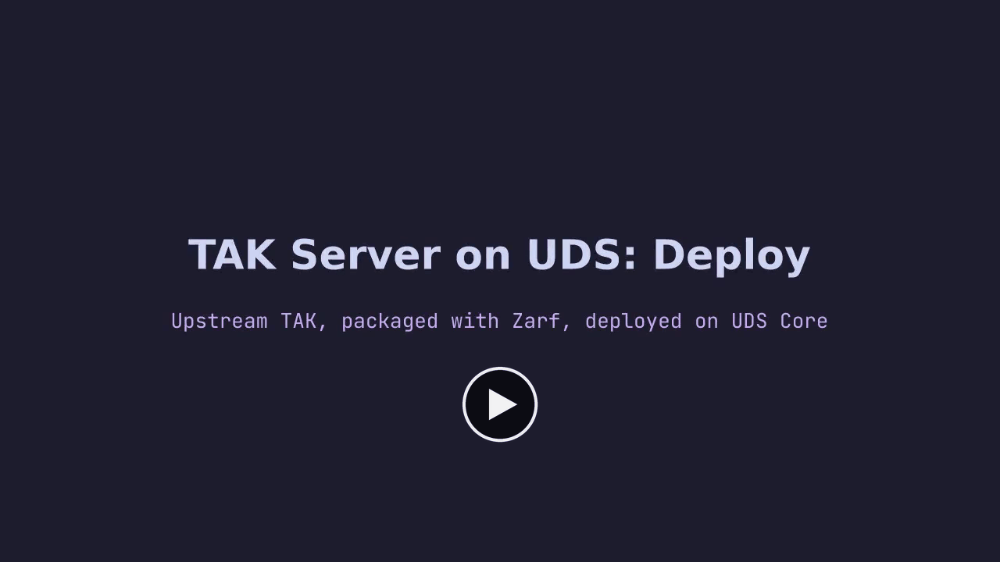
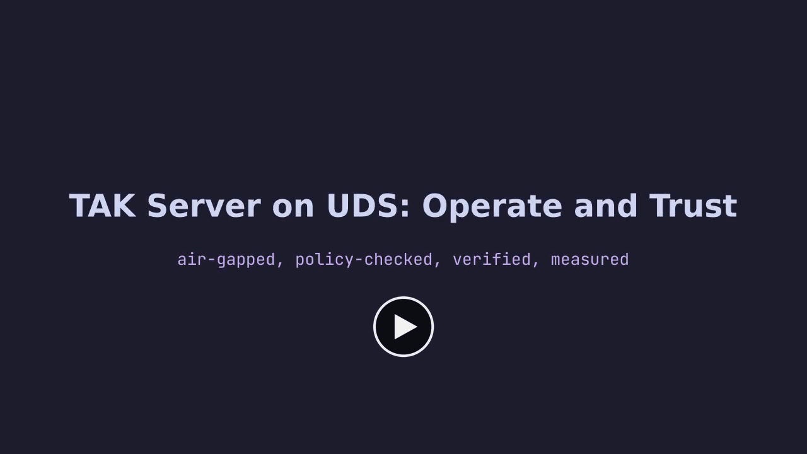
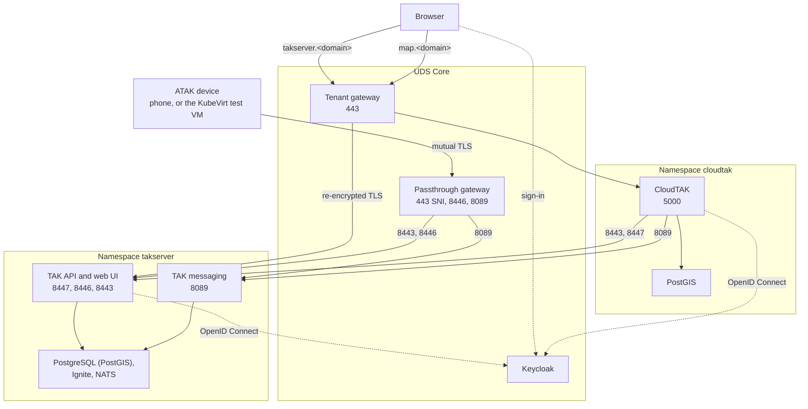
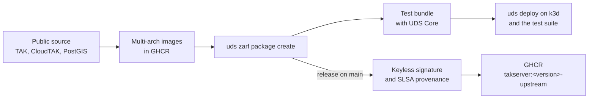

# uds-k3d-takserver

[](https://github.com/jonathanagustin/uds-k3d-takserver/releases/latest)
[](https://github.com/jonathanagustin/uds-k3d-takserver/actions/workflows/test.yaml)
[](https://securityscorecards.dev/viewer/?uri=github.com/jonathanagustin/uds-k3d-takserver)
[](https://www.bestpractices.dev/projects/15775)
[](LICENSE)

[TAK Server](https://github.com/TAK-Product-Center/Server), the open-source Team Awareness Kit server, packaged for [UDS](https://docs.defenseunicorns.com/core/). It deploys the upstream TAK Server Helm chart (`5.7-RELEASE-14`) onto UDS Core with Keycloak sign-in, the browser map client [CloudTAK](https://github.com/dfpc-coe/CloudTAK), and default-deny networking. It is built and tested on a local k3d cluster running `k3d-core-slim-dev` (UDS Core 1.15.2), on amd64 and arm64.

> **Status:** pre-1.0 and under active development. See [Known limitations](#known-limitations).

## Demo

<table>
  <tr>
    <td width="50%" valign="top">
      <a href="https://github.com/jonathanagustin/uds-k3d-takserver/releases/download/v0.5.1/demo-deploy.mp4"></a>
      <br><b>Deploy</b> (3 min)
      <br>Build the Zarf package, bundle it with UDS Core, deploy it, sign in through Keycloak, and connect a real ATAK device.
    </td>
    <td width="50%" valign="top">
      <a href="https://github.com/jonathanagustin/uds-k3d-takserver/releases/download/v0.5.1/demo-operate-and-trust.mp4"></a>
      <br><b>Operate and Trust</b> (4 min)
      <br>Air-gapped install, policy at work, CloudTAK and ATAK in sync, security defaults, upgrades, and self-healing.
    </td>
  </tr>
</table>

<details>
<summary>Chapters</summary>

**Deploy:**
0:05 UDS Core (Slim) on a New k3d Cluster ·
0:15 Build the Zarf Package ·
0:24 Bundle the Package with UDS Core ·
0:32 Deploy the Bundle ·
0:44 Package Ready ·
1:08 Sign In through UDS SSO ·
1:38 A Real ATAK Device on the Same Server

**Operate and Trust:**
0:04 Air-Gapped Install ·
0:38 Policy at Work ·
1:03 CloudTAK and ATAK in Sync ·
1:48 Secure by Default ·
3:04 Upgrades from the Last Signed Release ·
3:11 Footprint and Self-Healing ·
3:48 What This Does Not Prove

</details>

## What you get

- **Upstream chart, not a fork.** Zarf pulls the public TAK Server chart at package time. A small config chart in `chart/` adds the UDS `Package` and the ConfigMaps the upstream chart mounts.
- **Keycloak single sign-on.** The UDS operator registers the Keycloak client, and TAK's own OpenID Connect client handles browser sign-in. Keycloak groups map to TAK roles and groups. See [docs/sso.md](docs/sso.md).
- **Certificates made at deploy time.** A pre-install Job runs TAK's `generateClusterCerts.sh`. No keys or keystores are in git or in any image. See [ADR 2](adr/0002-generate-certificates-at-deploy-time.md).
- **UDS networking.** The browser UI goes through the tenant gateway. Certificate traffic (API, enrollment, streaming) goes through the passthrough gateway, including the standard TAK ports 8446 and 8089. NetworkPolicies are default-deny, with explicit per-workload rules. See [docs/networking.md](docs/networking.md).
- **CloudTAK in the browser.** The optional `cloudtak` component (on by default) runs CloudTAK v13.112.3 at `map.<domain>` with its own PostGIS database. Each Keycloak user gets their own TAK certificate. See [docs/cloudtak.md](docs/cloudtak.md).
- **A real ATAK test device.** `atak/` runs ATAK-CIV 5.5.1.10, built from public source, in an Android VM under KubeVirt. It connects to TAK over mutual TLS on 8089 like a field device. It is a separate package for amd64 nodes with KVM. See [docs/atak-device.md](docs/atak-device.md).
- **Images built from source.** The six TAK images, CloudTAK, and PostGIS are built here for amd64 and arm64 and published to GHCR. CI tags each build by a hash of its inputs, so a pull request always tests its own images. See [docs/building.md](docs/building.md).
- **Signed releases.** Each release package is signed keylessly with Sigstore, and its build provenance (SLSA v1) is attested in GHCR and attached to the GitHub release. See [Verify a release](#verify-a-release).
- **Supply-chain checks.** CI runs Grype scans, SBOMs, CodeQL, dependency review, and OpenSSF Scorecard. Renovate keeps dependencies current.

## Prerequisites

You need Docker, [k3d](https://k3d.io/), and the [UDS CLI](https://github.com/defenseunicorns/uds-cli) (which includes Zarf). kubectl is optional: `uds zarf tools kubectl` does the same job. The [UDS local demo requirements](https://docs.defenseunicorns.com/core/getting-started/local-demo/basic-requirements/) call for at least 4 CPU, 10 GiB of memory, and 40 GiB of disk for Docker.

The versions below match what this repository pins and tests with: k3d v5.9.0, UDS CLI v0.40.0 (`mise.toml`), and kubectl v1.37.1 for the k3s v1.37.1 cluster that `k3d-core-slim-dev` creates.

### Install with curl (Linux and macOS)

Each block downloads one pinned release for your OS and CPU, checks it against the published SHA-256 checksum, and installs it to `/usr/local/bin`. Run the first block once in the shell you use for the others:

```bash
OS="$(uname -s)"                                   # Linux or Darwin
os="$(echo "${OS}" | tr '[:upper:]' '[:lower:]')"  # linux or darwin
ARCH="$(uname -m | sed 's/x86_64/amd64/; s/aarch64/arm64/')"
if command -v sha256sum >/dev/null; then sha() { sha256sum -c -; }; else sha() { shasum -a 256 -c -; }; fi
cd "$(mktemp -d)"
```

UDS CLI:

```bash
UDS_VERSION=v0.40.0
f="uds-cli_${UDS_VERSION}_${OS}_${ARCH}"
curl -fsSLO "https://github.com/defenseunicorns/uds-cli/releases/download/${UDS_VERSION}/${f}" &&
  curl -fsSL "https://github.com/defenseunicorns/uds-cli/releases/download/${UDS_VERSION}/checksums.txt" | grep " ${f}\$" | sha &&
  sudo install -m 0755 "${f}" /usr/local/bin/uds
```

k3d:

```bash
K3D_VERSION=v5.9.0
f="k3d-${os}-${ARCH}"
curl -fsSLO "https://github.com/k3d-io/k3d/releases/download/${K3D_VERSION}/${f}" &&
  curl -fsSL "https://github.com/k3d-io/k3d/releases/download/${K3D_VERSION}/checksums.txt" | grep "/${f}\$" | sed 's|_dist/||' | sha &&
  sudo install -m 0755 "${f}" /usr/local/bin/k3d
```

kubectl (optional):

```bash
KUBECTL_VERSION=v1.37.1
curl -fsSLO "https://dl.k8s.io/release/${KUBECTL_VERSION}/bin/${os}/${ARCH}/kubectl" &&
  echo "$(curl -fsSL "https://dl.k8s.io/release/${KUBECTL_VERSION}/bin/${os}/${ARCH}/kubectl.sha256")  kubectl" | sha &&
  sudo install -m 0755 kubectl /usr/local/bin/kubectl
```

Then check them with `uds version`, `k3d version`, and `kubectl version --client`.

### Other install routes

| Tool | Homebrew (macOS and Linux) | apt / dnf |
| --- | --- | --- |
| UDS CLI | `brew tap defenseunicorns/tap && brew install uds` | No repository. Each [release](https://github.com/defenseunicorns/uds-cli/releases/tag/v0.40.0) has `.deb` and `.rpm` files for `apt install ./<file>.deb` or `dnf install ./<file>.rpm` |
| k3d | `brew install k3d` | None |
| kubectl | `brew install kubernetes-cli` | The official [pkgs.k8s.io repository](https://kubernetes.io/docs/tasks/tools/install-kubectl-linux/#install-using-native-package-management) (`core:/stable:/v1.37`) |
| Docker | [Docker Desktop](https://docs.docker.com/desktop/) | Docker's official repositories for [Ubuntu](https://docs.docker.com/engine/install/ubuntu/), [Debian](https://docs.docker.com/engine/install/debian/), and [Fedora](https://docs.docker.com/engine/install/fedora/) |

Homebrew installs the current release, which can be newer than the pins above. Podman can build the images (`CONTAINER_RUNTIME=podman`), but only Docker is tested.

To work on the repository itself, [mise](https://mise.jdx.dev/) installs every pinned tool except Docker, including the linters and test tools in [`mise.toml`](mise.toml): run `mise install`.

## Quick start

```bash
git clone --recurse-submodules --shallow-submodules https://github.com/jonathanagustin/uds-k3d-takserver
cd uds-k3d-takserver

# Create the package, deploy k3d-core-slim-dev, deploy the test bundle,
# create a Keycloak test user, and run the validation suite.
uds run test-install
```

Then open `https://takserver.uds.dev/` for TAK Server and `https://map.uds.dev/` for CloudTAK, and sign in through Keycloak.

Creating the package pulls the published images from GHCR and Docker Hub, so you do not need to build them first. `build.sh` also checks out the TAK source submodule if you cloned without it.

| Task | What it does |
| --- | --- |
| `uds run test-install` | New k3d cluster, package, test bundle, and the full test suite (same as `uds run default`) |
| `uds run dev` | Create the package and bundle, then deploy onto an existing cluster |
| `uds run test-upgrade` | Install the latest published release, then upgrade to the current branch |
| `uds run create-dev-package` | Create the Zarf package without an SBOM |
| `uds run build-image` | Build the six TAK images from the public source (`PUSH_IMAGES=true` pushes them) |
| `uds run publish-package` | Create the package with its SBOM, test it, and publish it |
| `uds run lint:all` | YAML, shell, Zarf, Helm, and license-header checks |
| `uds run cleanup` | Delete the k3d cluster and local package tarballs |

Run `uds run --list` for the rest. `hk check` runs the pre-commit checks in [`hk.pkl`](hk.pkl). Run `hk install` once to use them as a git hook.

### Deploy a release

Releases are published as `oci://ghcr.io/jonathanagustin/uds-k3d-takserver/takserver:<version>-upstream`, with one entry per architecture. Add it to a UDS bundle next to UDS Core with the [`keylessVerification`](#verify-a-release) block below, or deploy it directly onto a cluster that already runs UDS Core with the passthrough gateway:

```bash
uds zarf package deploy oci://ghcr.io/jonathanagustin/uds-k3d-takserver/takserver:0.5.1-upstream --confirm
```

Pass `--architecture amd64` or `--architecture arm64` when the cluster differs from the machine you deploy from. See [ADR 10](adr/0010-amd64-and-arm64.md).

## Verify a release

From v0.4.0 on, each release package is signed keylessly by `.github/workflows/release.yaml` on `main`, and the signature is in the public Sigstore transparency log. Check it before you deploy, once per architecture:

```bash
uds zarf package verify oci://ghcr.io/jonathanagustin/uds-k3d-takserver/takserver:0.5.1-upstream \
  --architecture amd64 \
  --certificate-identity-regexp '^https://github\.com/jonathanagustin/uds-k3d-takserver/\.github/workflows/release\.yaml@refs/(tags/v[0-9]+\.[0-9]+\.[0-9]+|heads/main)$' \
  --certificate-oidc-issuer https://token.actions.githubusercontent.com
```

In a UDS bundle, put the same check on the package entry, as `core-base` has in [bundle/uds-bundle.yaml](bundle/uds-bundle.yaml):

```yaml
  - name: takserver
    repository: ghcr.io/jonathanagustin/uds-k3d-takserver/takserver
    ref: 0.5.1-upstream
    keylessVerification:
      certificateIdentityRegexp: "^https://github\\.com/jonathanagustin/uds-k3d-takserver/\\.github/workflows/release\\.yaml@refs/(tags/v[0-9]+\\.[0-9]+\\.[0-9]+|heads/main)$"
      certificateOIDCIssuer: https://token.actions.githubusercontent.com
```

The package index also has signed SLSA v1 build provenance, stored in GHCR and in the repository's attestations. Check it with the [GitHub CLI](https://cli.github.com/):

```bash
gh attestation verify oci://ghcr.io/jonathanagustin/uds-k3d-takserver/takserver:0.5.1-upstream \
  --owner jonathanagustin
```

Each release also has the same provenance as a Sigstore bundle, `takserver-<version>-upstream.provenance.sigstore.json`. To check against that file instead, add `--bundle <file>`.

## Architecture



The TAK namespace runs in the Istio ambient mesh with default-deny NetworkPolicies, and every flow above has an explicit allow rule from the UDS `Package`. The browser UI is the only TAK path through the tenant gateway. Certificate clients go through the passthrough gateway, so TLS ends at TAK Server and TAK checks the client certificate itself.

Zarf installs the config chart (`chart/`) before the upstream chart. The config chart creates the `core-config` and `tak-ignite-config` ConfigMaps and the `reg-cred` Secret, and runs the pre-install Job that generates certificates. The `takserver-oidc` Pepr module adds an init container to the config, messaging, API, and plugins pods that writes the OIDC client secret into `CoreConfig.xml` before TAK Server starts.

### Build and release



Release Please opens a release pull request from the Conventional Commit titles. Merging it tags the release, and `release.yaml` creates, signs, verifies, and publishes the package for each architecture, then attests its provenance.

## Access

| Use | Host | Gateway | Service port |
| --- | --- | --- | --- |
| Browser UI (Keycloak sign-in) | `takserver.<domain>` | tenant, 443, re-encrypted to TAK | 8447 |
| CloudTAK map (Keycloak sign-in) | `map.<domain>` | tenant, 443 | 5000 in namespace `cloudtak` |
| Admin UI and API with a client certificate | `takserver-api.<domain>` | passthrough, 443 SNI | 8443 |
| Certificate enrollment | `takserver.<domain>` | passthrough, 443 SNI or 8446 | 8446 |
| Streaming (ATAK, WinTAK) | `takserver-stream.<domain>` | passthrough, 443 SNI or 8089 | 8089 |
| ATAK test device screen (optional) | `atak.<domain>` | tenant, 443 | 8000 in namespace `atak` |

`<domain>` defaults to `uds.dev`. Ports 8443 and 8089 require a client certificate. A client can enroll on `<host>:8446` and stream to the same `<host>:8089`, the way ATAK expects ([ADR 12](adr/0012-standard-tak-ports-on-the-passthrough-gateway.md)).

**Browser sign-in:** members of the Keycloak group `/UDS Core/Admin` get `ROLE_ADMIN`. Groups under `/TAK/` with a `_READ` or `_WRITE` suffix become TAK groups. For example, `/TAK/Operators_READ` becomes the TAK group `Operators`.

**TAK clients:** the deploy-time Job writes the CA and an admin certificate to the ConfigMap `cert-migration`. Import the CA into the client trust store, then use the admin certificate or enroll a user certificate on 8446 with a bearer token from the browser session. On k3d, host port 443 is the tenant gateway, so passthrough hosts need a port-forward to `passthrough-ingressgateway` or a load balancer in front of it. See [docs/sso.md](docs/sso.md) and [docs/networking.md](docs/networking.md).

## Configuration

| Variable | Default | Purpose |
| --- | --- | --- |
| `DOMAIN` | `uds.dev` | Domain suffix for gateway hosts |
| `TAK_IMAGE_TAG` | `5.7-RELEASE-14` | Tag of the TAK images under `ghcr.io/jonathanagustin/uds-k3d-takserver` |

`values/common-values.yaml` is the overlay for the upstream chart. `bundle/test-values.yaml` is applied only by the test bundle and sizes TAK Server for a small node. See [docs/configuration.md](docs/configuration.md).

## Supported architectures

| Architecture | Images | Zarf package | Tested in CI |
| --- | --- | --- | --- |
| `amd64` (x86_64) | yes | yes | install and upgrade |
| `arm64` (aarch64) | yes | yes | install |

The images are multi-arch: one tag serves both. Zarf packages are per architecture, and `uds run create-dev-package` builds for the machine you run it on. To build for the other one:

```bash
uds zarf package create . --flavor upstream --architecture arm64 --confirm
```

The ATAK test device is amd64 only and needs KVM on the node.

## Testing

`uds run test-install` runs the full suite against a new `k3d-core-slim-dev` cluster. The checks are in [`tasks/test.yaml`](tasks/test.yaml) and [`tests/`](tests/):

- Pod health, Istio mesh, UDS policy, and gateway checks.
- `tests/api-smoke.sh` exercises the Marti API on 8443, 8447, and 8446, and streams a CoT event on 8089.
- `tests/oidc-render.sh` checks that every TAK pod rendered the OIDC client secret.
- Playwright tests sign in through Keycloak, check the admin role and mapped groups, enroll a client certificate on 8446, and open the admin UI with a client certificate.
- The CloudTAK tests go from `map.<domain>` to the Keycloak login and back as that user, and require a live TAK connection with that user's certificate.

In GitHub Actions, the Test workflow runs install on amd64 and arm64 and the upgrade from the last release. The ATAK e2e workflow deploys the KubeVirt device and checks that it connects. The EKS, RKE2, and AKS workflows are manual, use the OpenTofu scaffolds in `.github/test-infra/`, and need cloud credentials.

## Repository layout

| Path | Purpose |
| --- | --- |
| `zarf.yaml`, `common/zarf.yaml` | Package metadata, variables, images, and the `takserver` and `cloudtak` components |
| `chart/` | Config chart: UDS `Package`, ConfigMaps, standard TAK ports, and the certificate Job |
| `charts/cloudtak/` | CloudTAK chart: Deployment, PostGIS, and its UDS `Package` |
| `values/` | Values overlays for the upstream chart and the Pepr module |
| `pepr/` | `takserver-oidc` Pepr module that adds the OIDC init container |
| `bundle/` | Test bundle (UDS Core passthrough gateway plus this package), `uds-config.yaml`, and `test-values.yaml` |
| `atak/` | Optional ATAK test device: KubeVirt package, VM, viewer, and APK build |
| `upstream/` | Git submodules: TAK Server, CloudTAK, and ATAK-CIV source at pinned tags |
| `tasks.yaml`, `tasks/` | `uds run` tasks, built on [uds-common](https://github.com/defenseunicorns/uds-common) |
| `tests/` | API smoke scripts, upgrade checks, and Playwright tests |
| `demo/` | Scripts that record the demo videos |
| `docs/`, `adr/` | Documentation and architecture decision records |
| `.github/` | CI workflows, image builds, and test infrastructure |

The layout follows the [UDS package guide](https://docs.defenseunicorns.com/core/how-to-guides/packaging-applications/create-uds-package/) and [uds-packages/reference-package](https://github.com/uds-packages/reference-package).

## Documentation

| Doc | Covers |
| --- | --- |
| [Configuration](docs/configuration.md) | Zarf variables, the values overlay, resource sizing, and what the config chart mounts |
| [Single sign-on](docs/sso.md) | Keycloak client, group mapping, and certificate enrollment |
| [Networking](docs/networking.md) | Gateway exposure, standard TAK ports, and the NetworkPolicy allow list |
| [CloudTAK](docs/cloudtak.md) | The browser map client: image, sign-in, TAK connection, rules, and limits |
| [ATAK test device](docs/atak-device.md) | ATAK-CIV in a KubeVirt VM, its certificate, and its test location |
| [Building the images](docs/building.md) | Image builds, platforms, pins, input-keyed tags, and the build cache |
| [Data](docs/data.md) | PostgreSQL and what a backup of the namespace must include |
| [Policy exemptions](docs/justifications.md) | Every UDS policy exemption, why it exists, and the package requirements not met yet |
| [Decisions](adr/) | Architecture decision records, from certificates at deploy time to the ATAK device |

## Known limitations

- On k3d, host ports 8446 and 8089 are not mapped, and host port 443 is the tenant gateway. Reach the passthrough gateway with a port-forward or a load balancer.
- Ports 8444, 9000, and 9001 are not exposed through a gateway.
- The upstream chart renders the `postgres-configuration` ConfigMap with empty `pg_hba.conf` and `postgres.conf` keys.
- The upstream chart does not mount the `uds-trust-bundle` ConfigMap. The API and messaging init containers import it into a copy of the JVM trust store instead. See [docs/sso.md](docs/sso.md).
- Some deploy-time Zarf actions need `python3` on the deploy host. See [Policy exemptions](docs/justifications.md#uds-package-requirements).
- CloudTAK has no OpenID Connect route of its own yet ([upstream issue #661](https://github.com/dfpc-coe/CloudTAK/issues/661)), so this package adds the Keycloak sign-in route in the CloudTAK pod. CloudTAK logout does not end the Keycloak session. Its default basemap is OpenStreetMap through a tile proxy in its pod; set `basemap.enabled: false` where the cluster cannot reach it. Features that need S3 are not available. See [docs/cloudtak.md](docs/cloudtak.md).
- Resource requests are sized for a small development node, and NATS runs as a single replica. Production sizing and storage are not tuned yet.

## Contributing

See [CONTRIBUTING.md](CONTRIBUTING.md) for bugs, feature requests, and pull requests, including the coding standards and test policy. Pull request titles follow [Conventional Commits](https://www.conventionalcommits.org/), which [Release Please](https://github.com/googleapis/release-please) uses for releases. [Renovate](https://docs.renovatebot.com/) opens dependency updates, with major versions in their own pull requests.

## Security

Report vulnerabilities through a private GitHub security advisory. See [SECURITY.md](SECURITY.md).

## License

[GPL-3.0-only](LICENSE). TAK Server, which the TAK images are built from, is also GPL-3.0. CloudTAK, which the `cloudtak` image is built from, is AGPL-3.0. ATAK-CIV, used only for the test device, is GPL-3.0.
