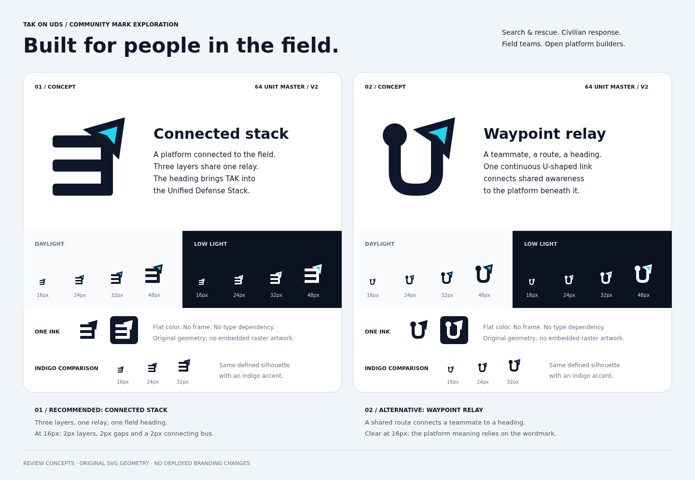
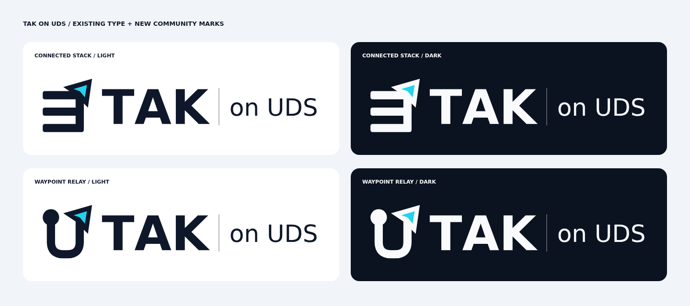

<!-- Copyright 2026 uds-takserver authors; SPDX-License-Identifier: GPL-3.0-only -->

# Community logo concepts

Two original, non-mascot directions for TAK on the **Unified Defense Stack (UDS)**,
prepared for [#411](https://github.com/jonathanagustin/uds-takserver/issues/411).
This second pass starts with the favicon and refines the existing concept geometry.
The design connects field mapping and shared awareness to an integrated platform
for applications, identity, networking, security and operations. All work remains
in this review directory.



## Recommendation

**Connected stack** (`stack-relay`) is recommended. Three substantial platform
layers share one vertical connection ending in a navigation heading. It gives
UDS a visible role alongside TAK. The layers represent integration, rather than
an inventory of exactly three services. Its clear, open structure works for
civilian response and search and rescue as well as defense field teams.

**Waypoint relay** (`trail-relay`) connects a teammate node through a U-shaped
route to a navigation heading. Its open U and two different endpoints make an
accessible field mark, but the integrated platform meaning depends more on the
wordmark. It remains a viable simpler alternative.

Both marks were inspected in Chromium at **16, 24 and 32 CSS pixels at device
scale 1**, on light and dark surfaces, in color and one ink. At 16px the connected
stack has three 2px layers, two 2px gaps and a 2px connecting spine; the parallel
layers remain separated. The waypoint relay retains its open center, teammate
node and heading, although the node/line distinction is less prominent at 16px.
The navigation tip remains small in both directions. Its cyan inset is decorative:
recognition depends on the outer silhouette, which remains present in one ink.

Compared with the first pass, the stack now uses whole-pixel widths and gaps at
16px. Both headings have a substantial navy/white surround, so a low-contrast cyan
edge no longer defines the silhouette against white. The **cyan version is the
recommendation**; indigo is retained as an accent comparison and is subtler within
the navy heading.

## Files and intended use

| File | Purpose |
| --- | --- |
| [index.html](index.html) | Responsive side-by-side review, native favicon sizes, docs header, app tile and watermark mockups |
| [review-sheet.svg](review-sheet.svg) / [PNG](review-sheet.png) | Vector comparison and Chromium screenshot |
| [wordmark-sheet.svg](wordmark-sheet.svg) / [PNG](wordmark-sheet.png) | Horizontal wordmarks on light and dark surfaces |
| [usage-proof.png](usage-proof.png) | Chromium screenshot of the full review page and use-scale mockups |
| `stack-relay-{light,dark,mono,indigo}.svg` | Recommended 64-unit connected stack |
| `trail-relay-{light,dark,mono,indigo}.svg` | Alternative 64-unit waypoint relay |
| `*-wordmark-{light,dark}.svg` | 770 × 192 horizontal wordmarks using existing outlined project lettering |
| `favicon-proof/*-{16,24,32}.png` | 24 exact-size transparent browser exports for inspection; SVGs are the deliverables |
| [build-preview.py](build-preview.py) | Original, hand-authored geometry and reproducible SVG/HTML assembly |
| [render-preview.cjs](render-preview.cjs) | Chromium proof rendering with an isolated browser profile and loopback server |



Use `light` on white/light backgrounds and `dark` on deep navy/dark backgrounds.
The mark palette is navy `#0F172A`, white `#F8FAFC` and cyan `#22D3EE`; preview dark
surfaces use `#0B1220`. The comparison accent is indigo `#4F46E5`.
All standalone marks and wordmarks have transparent backgrounds and accessible
titles. Their viewBoxes remain `0 0 64 64` and `0 0 770 192` respectively.

The `mono` SVG uses `currentColor`. Set CSS `color` when embedding it inline;
an SVG loaded through `` does not inherit the surrounding page's text color
and defaults to black. For a white standalone mono file, replace `currentColor`
with the intended white ink in the SVG. Preserve at least 8 units of clear space
outside the 64-unit mark viewBox. Use the wordmark at 154px wide or larger; below
that size prefer the standalone mark and accessible adjacent project name.

Artwork uses only SVG paths, rectangles, circles and groups. There are no external
references, embedded raster images, gradients, filters, scripts, or font
requirements in the standalone artwork. The horizontal wordmarks preserve the
repository's existing outlined lettering. The symbols are original geometry;
they do not reproduce official TAK or UDS artwork. Annotations in preview sheets
use system fonts.

## Reproduce and validate

Run from this directory:

```sh
python3 build-preview.py
# With playwright-core installed and Chromium available:
node render-preview.cjs
```

Set `PLAYWRIGHT_MODULE` to a module path and `CHROMIUM_PATH` to the browser executable
if they are not in the default locations. No user browser profile is opened.
The renderer serves this checkout on an ephemeral loopback port, creates the
proofs, checks for page/resource errors and mobile horizontal overflow, then closes
the browser and server. `--no-sandbox` supports the isolated cloud container;
only this trusted local preview is loaded.

Validation for this revision: all SVGs parsed as XML; standalone artwork was
checked for titles, stable viewBoxes and forbidden external/raster/script content.
The 24 favicon PNGs have exact stated dimensions and transparent backgrounds.
The Chromium overview, native-size examples, wordmarks and usage mockups were
visually inspected. The review page has no horizontal overflow at 390px width.
The previews show intended use; they do not modify production navigation, README,
social imagery or historical demo footage.
