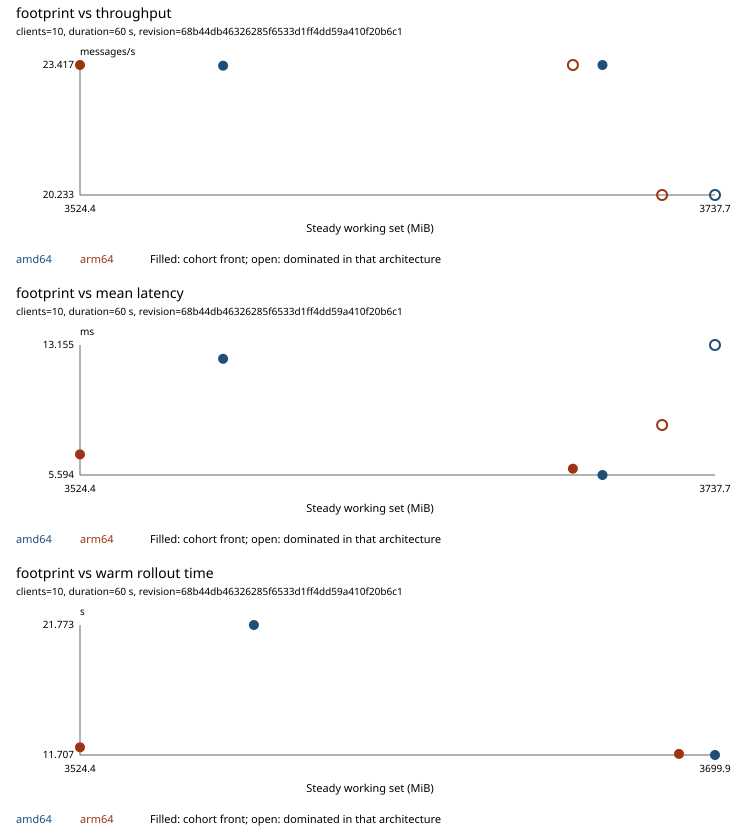

# Ten-client observations on both architectures

This snapshot does not justify a tuning change or a performance-based architecture default. It preserves six measured points from [Benchmark run 42361079121](https://github.com/jonathanagustin/uds-k3d-takserver/actions/runs/42361079121), started November 7, 2026, at source revision `68b44db46326285f6533d1ff4dd59a410f20b6c1`. Each point used 10 clients for 60 seconds, once, in a sequential sweep.

Both benchmark jobs failed because CloudTAK had restarted before the baseline cold-age collection. The records were still uploaded. Each baseline record preserves that collection error and a null cold-age value. The four Postgres-config records have no collection errors. The load and per-pod startup fields below are observations, not evidence that the complete install had a valid cold-start measurement.

## What was observed

| Architecture | Config | Total steady working set (MiB) | Received messages/s | Mean ping-pong (ms) | Postgres peak working set (MiB) |
| --- | --- | --- | --- | --- | --- |
| amd64 | baseline | 3737.71 | 20.233 | 13.155 | 71.36 |
| amd64 | postgis-buffers | 3572.48 | 23.400 | 12.351 | 37.67 |
| amd64 | postgis-wal | 3699.93 | 23.417 | 5.594 | 32.16 |
| arm64 | baseline | 3719.94 | 20.233 | 8.501 | 72.36 |
| arm64 | postgis-buffers | 3524.43 | 23.417 | 6.795 | 37.60 |
| arm64 | postgis-wal | 3689.98 | 23.417 | 5.962 | 32.64 |

The total working set covers the `takserver` and `cloudtak` namespaces. It is not messaging's per-container peak or process RSS. All six Postgres points had zero requested and zero timed checkpoints in this short window and no temporary files. The source records retain the settings and cache counters alongside the measurements.



The [full generated report](front.md) includes the startup phases, CPU, memory, Postgres fields and collection caveats. Its fronts are descriptive for this one workload cohort. A point on this front is not a capacity recommendation.

## Limits on interpretation

- Ten clients do not separate the throughput of the two Postgres configurations: the measured rates are about 23.4 messages/s on both architectures. The baseline was measured earlier in the sweep, so its lower rate cannot be attributed to Postgres settings alone.
- A 60-second window with no checkpoint does not test the operational effect of the five- and fifteen-minute checkpoint settings. A single observation per config also cannot separate a setting's effect from warmup and host noise.
- Mean latency varies across the points and architectures. The tester stores no latency histogram, so p95 is unavailable. This snapshot does not establish a general latency winner.
- The startup table describes the pods present at collection time. Postgres-only configs reuse an earlier TAK pod; repeated phase rows are not independent cold/warm repetitions. The initial install reference is not ranked against warm rollout times. No class-loading breakdown was collected, so a CDS archive or probe change is not justified here.
- Aggregate working set cannot establish messaging's headroom under its own limit. These older records have no per-container capacity evidence. They do not justify a 200-client dispatch.

Keep the current Postgres defaults and both supported architectures. For development, use the host's native architecture. CI should continue testing both on native runners. Deployment should follow the target platform and a representative capacity test; this light-load snapshot supplies no performance-based default. [ADR 10](../../../adr/0010-amd64-and-arm64.md) records that bounded conclusion.

## Sources and reproduction

[sources.json](sources.json) records the source revision, artifact IDs/URLs and SHA-256 of every retained JSON file. The six files under `records/` are byte-for-byte copies from the two architecture artifacts, rather than reconstructed measurements. Artifact retention is finite; these retained records keep the evidence inspectable after the download expires. No log, certificate, private key or credential is included.

The corrected reporter is from revision `a7e0068b9ef026e5b1a63b48f9dcfbcd89337abf`, implemented in [PR 338](https://github.com/jonathanagustin/uds-k3d-takserver/pull/338). From a checkout containing that reporter:

```bash
python3 bench/report.py /tmp/bench-42361079121 \
  bench/results/42361079121/records/amd64/*.json \
  bench/results/42361079121/records/arm64/*.json
```

The later [10/50-client run 42423617387](https://github.com/jonathanagustin/uds-k3d-takserver/actions/runs/42423617387) and [50-client capacity run 42425167527](https://github.com/jonathanagustin/uds-k3d-takserver/actions/runs/42425167527) were still running when this snapshot was prepared. Their results are not included or anticipated here. Issues [48](https://github.com/jonathanagustin/uds-k3d-takserver/issues/48), [49](https://github.com/jonathanagustin/uds-k3d-takserver/issues/49) and [51](https://github.com/jonathanagustin/uds-k3d-takserver/issues/51) remain open for the heavier, controlled evidence.
