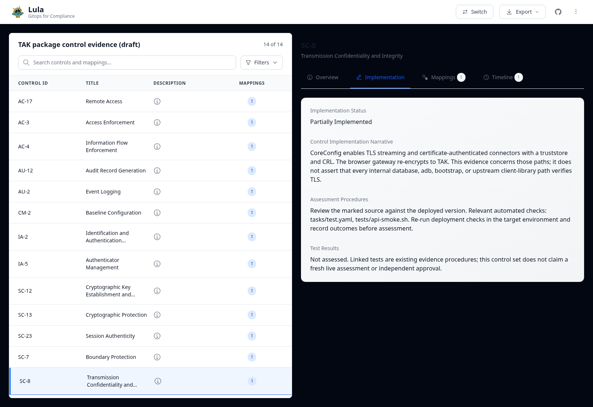

# Draft control evidence

This is a proposed set of package evidence for fourteen NIST SP 800-53 Rev. 5
base controls. It is not a complete NIST catalog, a deployment assessment,
certification, or authorization. Every control is **Partially Implemented**:
the narratives describe package behavior and the gaps that belong to Core,
upstream applications, the deployment, or organizational policy. Linked tests
are procedures to rerun, not claims that a new live assessment passed.

Issue [#37](https://github.com/jonathanagustin/uds-k3d-takserver/issues/37) was
explicitly deferred until Lula releases again or compliance becomes a priority.
The latest npm version is still 0.9.5, with registry activity last modified on
2026-03-12. Keep this change in draft until that maintainer decision changes.
All source associations have mapping status `planned` pending review; their
presence does not turn the parent control into an implemented control.

## Inspect the evidence

Use the pinned CLI from the repository root:

```bash
npx --yes lula2@0.9.5 ui --dir compliance --port 3000 --no-open-browser
```

Open `http://localhost:3000` locally. The UI is an editor with no application
authentication; use it on a trusted local machine and do not publish it.
The pinned CLI was opened locally with all fourteen controls and mappings,
and the implementation view was inspected:



Controls are under `controls/<family>/`, and proposed associations are under
`mappings/<family>/*-mappings.yaml`. Source locations are relative to the
repository root. The actual 0.9.5 `SourceEntry` schema uses `location`; the
README's older `source:` example is not used here.

```bash
uv run --no-project --with pyyaml==6.0.3 python -B .github/scripts/check-compliance.py
uv run --no-project --with pyyaml==6.0.3 python -B -m unittest tests.test_compliance_mappings -v
```

The checker rejects missing files, unsafe paths, unknown/duplicate UUIDs,
unknown control IDs, undeclared source locations, incomplete marker pairs, and
crossed markers. It scans tracked and untracked source files while respecting
Git ignore rules, so a new marker cannot silently bypass local validation.
Multiple distinct blocks may share a UUID when all locations are declared.

## What the workflow can prove

The Lula workflow validates mappings for every pull request. Its separate
crawler job has only `contents: read` and `pull-requests: write`, posts an
ordinary compliance comment with `--post-mode=comment`, and runs only on
non-draft pull requests from this repository. Fork pull requests still run the
marker validation; they receive no write-token execution.

Two verified limits in the pinned 0.9.5 CLI prevent claiming complete crawl
acceptance today:

- `crawl` calls `octokit.pulls.listFiles` without pagination or `per_page`.
  GitHub therefore returns at most the first 30 changed files. The workflow
  fails its preflight for larger pull requests instead of silently reporting
  no compliance impact. This draft itself adds more than 30 files.
- Its `getChangedBlocks` skips a UUID when the base file has no corresponding
  marked block. A pull request introducing markers does not demonstrate that
  later edits will produce the expected comment. After the marker set is
  merged by a maintainer, a separate small pull request must change an
  existing mapped block and verify the comment contains that UUID.

These observations come from the published `lula2@0.9.5` bundle's
`cli/commands/crawl.ts` code in `dist/index.js`. The tool is intentionally
pinned; this draft does not patch or silently replace its crawler.

## Evidence boundaries

- The SSO mappings cover configured gates, not MFA or identity proofing.
- The network/TLS mappings cover named paths, not every internal transport.
- Android 9 PKCS12 compatibility uses SHA-1/3DES. No FIPS claim is made.
- CA key custody, rotation, Secret encryption at rest, and recovery are partly
  deployment responsibilities. Current certificate revocation restarts TAK.
- The logging checks cover selected stdout/Loki events. File-only access,
  database audit, and ESAPI logs are not collected by those queries; retention
  and audit integrity need separate assessment.
- Cosign signing is optional, and provenance jobs do not establish mandatory
  verification for every runtime image pull.

The source mappings deliberately point at local call sites or verification
logic when the implementation is upstream-owned. In particular,
`publish-cert-configmap.sh` is supplied by the TAK image; the mapped cert-init
Job invokes it but this repository does not vendor that script.
