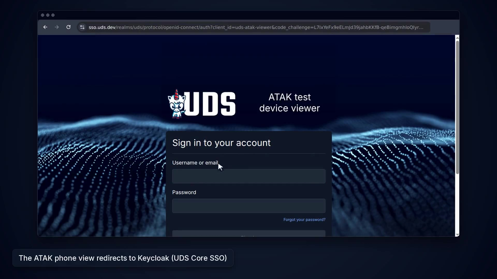
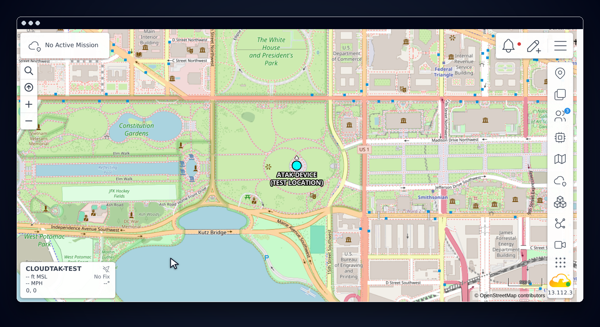

# ATAK test device

`atak/` runs the real ATAK-CIV Android app, built from the public source in the `upstream/atak-civ` submodule (tag 5.5.1.10), in an Android-x86 VM managed by KubeVirt. It behaves like a field device: it imports a connection data package with its client certificate, streams Cursor on Target (CoT) events on 8089 over mutual TLS, and shows up in `/Marti/api/clientEndPoints`. A phone view of its screen is served at `https://atak.<domain>/` behind Keycloak.

It is optional and separate from the TAK package. Nothing in `zarf.yaml` or the default tests deploys it. The dedicated workflow `.github/workflows/atak-e2e.yaml` builds and deploys it on the normal test cluster. See [ADR 14](../adr/0014-atak-test-device-in-kubevirt.md).

[](https://github.com/jonathanagustin/uds-k3d-takserver/releases/download/demo/demo-clip-atak-device.mp4)

## Requirements

- amd64 nodes with `/dev/kvm`. The VM image is Android-x86 and the APK is built for `x86_64` only. There is no arm64 build (see [Supported architectures](../README.md#supported-architectures)).
- About 3 GiB of memory and 2 vCPU for the VM, plus KubeVirt.
- The standard TAK streaming port 8089 on the passthrough gateway (`standardPorts` in `charts/takserver/values.yaml`, [ADR 12](../adr/0012-standard-tak-ports-on-the-passthrough-gateway.md)) and the in-cluster DNS rewrite, so the device can reach `takserver-stream.<domain>` the way a phone would.

## Images

| Image | Built from | Contents |
| --- | --- | --- |
| `atak-civ-vm` | `atak/vm/Dockerfile` | KubeVirt containerDisk: Android-x86 9.0-r2 kernel and initrd in `/boot`, the system as an ext4 qcow2 at `/disk/android.qcow2` (about 950 MB) |
| `atak-viewer` | `atak/viewer/Dockerfile` | ws-scrcpy v0.8.1 (MIT) with the shell and file listing compiled out, an adb client, and a phone-bezel page |
| `atak-driver` | `atak/apk/Dockerfile` target `driver` | The ATAK APK, adb, and `atak/driver/drive.sh`. Test tool only, not in the package |

The APK build (`atak/apk/Dockerfile`, driven by `atak/ci/build-apk.sh`) compiles the takthirdparty natives, the Conan dependencies, and cesium-native from source. A cold build takes well over an hour on a GitHub runner; the layers are cached in `ghcr.io/jonathanagustin/uds-k3d-takserver/build-cache`. No key, certificate, or password is in any image. The APK is signed with the debug keystore that ships in the public atak-civ repository.

CI tags each image with the ATAK version and a hash of its inputs, for example `atak-civ-vm:5.5.1.10-<hash>`. When that tag is in GitHub Container Registry (GHCR), CI pulls it. A pull request builds and pushes only the images whose inputs changed. Fork pull requests cannot push, so they build locally. After a passing e2e run on `main`, the plain `5.5.1.10` tags point at the tested images. `packages/atak-device:5.5.1.10` points at the tested Zarf package. See [Reused build outputs](ci.md#reused-build-outputs).

## Deploy

```bash
uds zarf package create atak --set ATAK_TAG=5.5.1.10 --confirm
uds zarf package deploy zarf-package-atak-device-amd64-*.tar.zst --set DOMAIN=uds.dev --confirm
```

Or deploy the package the last `main` run tested, without building it:

```bash
uds zarf package deploy oci://ghcr.io/jonathanagustin/uds-k3d-takserver/packages/atak-device:5.5.1.10 \
  --architecture amd64 --set DOMAIN=uds.dev --confirm
```

The package (`atak/zarf.yaml`) has two components:

- `kubevirt`: KubeVirt v1.9.1 (operator manifest pinned by checksum), the KubeVirt CR in `atak/deploy/kubevirt-cr.yaml`, and the UDS policy exemption it needs. Kubernetes 1.37, which CI runs (k3s v1.37.1), enforces numeric formats in custom resource definition (CRD) schemas. v1.6.x and v1.7.x declare the kernel and containerDisk checksums as int32, so a CRC32 above 2^31 makes every virtual machine instance (VMI) status update fail and the VMI stays `Scheduled` while the guest runs. Since v1.9.0 KubeVirt turns on every Beta feature gate by default, including `ImageVolume`. With it, the launcher pod gets the containerDisk, the kernel boot image and the `container-disk` binary as Kubernetes image volumes, and a container runtime without CRI image volume support mounts them empty, so the pod fails with `/container-disk-binary/usr/bin/container-disk: no such file or directory` ([kubevirt#17460](https://github.com/kubevirt/kubevirt/issues/17460), [k3s#14323](https://github.com/k3s-io/k3s/issues/14323)). The CR disables `ImageVolume`, so KubeVirt copies the binary with an init container and virt-handler mounts the disk as in v1.8. It also disables `Template`, whose virt-template images are not in the package.
- `atak-device`: the VM, Service `atak-device-adb`, the viewer Deployment, and the UDS Package `atak`. The Package's expose entry probes `https://atak.<domain>/phone.html`. That path is the viewer page. Authservice sits in front of it, and the operator's probe client is what the check uses.

## Device certificate

The device authenticates with a client certificate, the way a provisioned field device does. There is no password enrollment.

At run time `atak/ci/e2e.sh` applies a `TakClient` ([ADR 22](../adr/0022-takclient-operator.md)) for callsign `atak-device` in group `Operators`, waits for it to be `Ready`, and copies `package.zip` from Secret `takclients/atak-device` into Secret `atak/atak-device-dpk`, which the driver pod mounts. The `takserver-oidc` watcher does the work:

1. It signs a 30-day client certificate with `CN=atak-device` and `extendedKeyUsage = clientAuth` with the deploy-time TAK CA ([ADR 2](../adr/0002-generate-certificates-at-deploy-time.md)). The CA key is read from Secret `takserver/takserver-ca-key` into memory and is not written anywhere.
2. It registers `atak-device` as a TAK file user in `Operators` through TAK's admin API on 8443. TAK 5.7 maps a certificate to a user this way: `X509Authenticator` matches a client certificate against the file users by fingerprint or by the CN, and takes that user's groups. `Operators` is the group Keycloak users get, so the device and CloudTAK users see each other. A certificate with no file user still connects, but only in the anonymous group.
3. It builds a standard ATAK connection data package: `MANIFEST/manifest.xml`, `certs/server.pref` with one stream `takserver-stream.<domain>:8089:ssl` and its `caLocation0`, `caPassword0`, `certificateLocation0`, and `clientPassword0` entries, the client `certs/atak-device.p12`, and the CA in `certs/truststore.p12`. Both PKCS#12 files use SHA-1 and 3DES, which Android 9 reads, and a generated password. The CA certificate in the truststore has a friendlyName (`tak-ca`). Without one, Android's PKCS12 keystore lists no entry and ATAK reports "Unable to validate Truststore".

The driver installs the APK over adb, taps through the first-run prompts, pushes the package to `/sdcard/Download/atak-device.dpk`, and restarts ATAK. On start ATAK imports `Download/atak*.dpk` files (`PreferenceControl`), the normal import path for a provisioned device. The `.p12` files go to `atak/cert`, the `.pref` adds the stream with those certificates, and ATAK connects to 8089 over mutual TLS. The e2e job then looks for `atak-device` in `/Marti/api/subscriptions/all` and `/Marti/api/clientEndPoints`.

Inside the cluster `takserver.<domain>` resolves to the tenant gateway, so the device uses `takserver-stream.<domain>`. The viewer login uses the Keycloak user.

### Test location

The VM has no GPS, so the device reports a fixed test location instead.

Before ATAK's first start the driver stages a preferences file at `atak/config/prefs/defaults`. ATAK loads that file once at start-up and then deletes it (`PreferenceControl.ingestDefaults`). The file gives the device a fixed **test location** on the National Mall in Washington, DC (38.8895, -77.0353).

The file uses ATAK's own "restore location on restart" settings (`recordedLocation`, `restoreRecordedLocation`). ATAK's `RestoreLocationMapComponent` loads those settings as a mock self position when the map starts. The same file sets the GPS option to "external only" (`mockingOption` `IgnoreInternalGPS`), because there is no GPS receiver. It marks ATAK's GPS mode hint as seen (`atak.hint.gps.device.mode`). It sets `atakControlForcePortrait` so the screen fits the phone view. The file holds no secrets.

The location is not a GPS fix, and the device never presents it as one. The callsign is `ATAK-DEVICE (TEST LOCATION)`. TAK, CloudTAK, and other clients show that callsign next to the marker. `atak/ci/e2e.sh` checks that TAK's latest event from the device is at that point under that callsign.

The settings are not in the data package, because importing `restoreRecordedLocation` into a running ATAK makes it record the current (empty) self position over `recordedLocation`. Override the point with `TEST_LAT`, `TEST_LON`, and `CALLSIGN`.

After the device connects, the driver locks the map on the self marker and zooms in (`atak-test-location.png`). The self-coordinate overlay keeps a small red `NO GPS` source label. ATAK shows that label for any position that is not a live fix, including one placed by hand. That label is accurate for this device.



### Why not password enrollment

ATAK always enrolls on 8446 with HTTP Basic authentication (`CertificateEnrollmentClient` passes `passIsToken=false`). With `auth default="file"` TAK checks Basic credentials against its file authenticator and sends only bearer tokens to Keycloak, so a Keycloak password gets a 302 to the login page. Enrolling the device would need a TAK file user with a password. A certificate issued from the TAK CA needs no password user and matches how devices are provisioned in the field. The 8446 enrollment test in `tests/` still covers the enrollment endpoint.

### Provisioning device certificates

For a real device, apply a `TakClient` in namespace `takclients`:

```yaml
apiVersion: tak.jonathanagustin.github.io/v1alpha1
kind: TakClient
metadata:
  name: alpha-1
  namespace: takclients
spec:
  callsign: alpha-1
  groups:
    - Operators
  validityDays: 30
```

When `kubectl get takclient alpha-1 -n takclients` shows `Ready`, Secret `takclients/alpha-1` has `package.zip`. Copy it to the device's `Download` folder as `atak-alpha-1.dpk`, or open it with ATAK's Import Manager. The Secret also has `client.pem`, `client.key`, and `ca.pem` for other clients.

Delete the `TakClient` to remove the device. The watcher deletes the TAK user and adds the certificate's serial to the certificate revocation list (CRL) in Secret `takserver/takserver-crl`. UDS Core then restarts the TAK pods that mount it, and TAK rejects the certificate from then on. The restart drops every connected client for a few minutes. Until it finishes, the certificate still connects, with no groups. This restart is accepted for now. Issue [#288](https://github.com/jonathanagustin/uds-k3d-takserver/issues/288) tracks revocation without a restart. See [ADR 22](../adr/0022-takclient-operator.md).

## Network rules

The UDS Package `atak` sets ambient mesh for the viewer. The VM's launcher pod carries `istio.io/dataplane-mode: none` and stays out of the mesh. ztunnel hands inbound connections to the pod from inside its network namespace. That path bypasses KubeVirt's masquerade DNAT, so adb never reached the guest (`adb: device offline`). Its traffic is still limited by these NetworkPolicies, and TAK traffic is mutual TLS from the device to TAK. adb from the viewer and the driver to the device is plain TCP inside the cluster.

Rules:

| Direction | Peer | Port | Why |
| --- | --- | --- | --- |
| Egress | device to `istio-passthrough-gateway` pods `app=passthrough-ingressgateway` | 8089 | CoT streaming over mutual TLS |
| Ingress and egress | viewer and device | 5555 | adb for the screen view |
| Ingress and egress | driver (`app.kubernetes.io/name=atak-driver`) and device | 5555 | test driver |
| Expose | tenant gateway host `atak` to the viewer | 8000 | phone view, behind Authservice |

adb on the device has no authentication (`ro.adb.secure=0`). Only the viewer and the driver can reach it.

The viewer's Keycloak client is `uds-atak-viewer` and is limited to the group `/UDS Core/Admin`.

## Policy exemptions

`atak/deploy/kubevirt-exemption.yaml` is a UDS `Exemption` in `uds-policy-exemptions`:

- `virt-handler` runs privileged on the host (it manages `/dev/kvm`, cgroups, and the launcher's network): `DisallowPrivileged`, `RequireNonRootUser`, `DropAllCapabilities`, `RestrictCapabilities`, `RestrictHostPathWrite`, `RestrictVolumeTypes`, `DisallowHostNamespaces`, `RestrictSELinuxType`.
- `virt-operator`, `virt-api`, `virt-controller`, and `virt-exportproxy`: `RequireNonRootUser`, `DropAllCapabilities`, `RestrictVolumeTypes`.
- `virt-launcher-atak-device-*` in `atak` (the pod that runs QEMU, as UID 107): `RestrictCapabilities` (it adds `NET_BIND_SERVICE` for masquerade networking), `DropAllCapabilities`, `RestrictVolumeTypes`, `RestrictHostPathWrite`, `RestrictIstioTrafficOverrides` (KubeVirt always adds the `traffic.sidecar.istio.io/kubevirtInterfaces` annotation to launcher pods; only Istio sidecars read it, and there is no sidecar here).

## Android-x86 notes

- The initrd silences the kernel log unless `DEBUG` is set. `DEBUG=0` gives a verbose serial console without a debug shell.
- Android-x86 renames `eth0` to `wifi_eth` and adds a virtual Wi-Fi `wlan0`. `VIRT_WIFI=0` keeps `eth0` for the Ethernet service, which takes the KubeVirt masquerade DHCP lease (cluster DNS included). The NIC model is `e1000`.
- The ramdisk starts adbd on TCP 5555 and runs a boot report on the serial console (network, adb, display), keeps the screen on, and disables the crash-looping Android-x86 analytics app.
