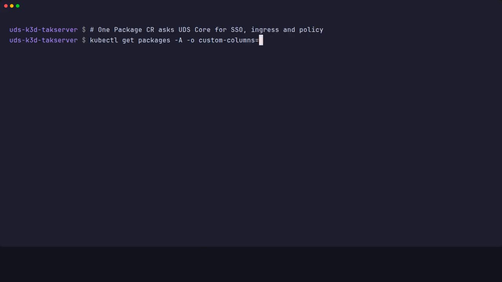
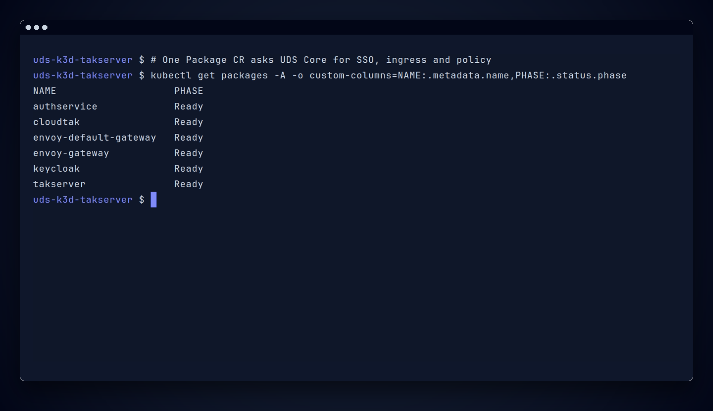
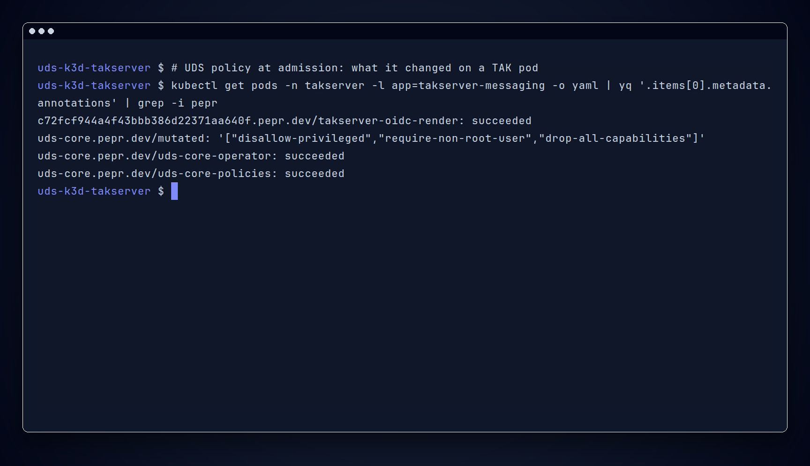

# Configuration

Use this page to configure the upstream TAK Server chart for Team Awareness Kit (TAK) clients with Zarf variables and the values overlay. It explains differences from the upstream example, plus sign-in, certificates, monitoring, logging, pod security, and startup order.

The package deploys the public TAK Server chart from [TAK-Product-Center/Server](https://github.com/TAK-Product-Center/Server) tag `5.7-RELEASE-14`, path `src/takserver-cluster/deployments/helm`. The chart is not copied into this repository. `common/zarf.yaml` points Zarf at that git uniform resource locator (URL). The chart version in that tag is `4.5.0`. It has no `values.yaml`. Its example values files are `developer-values.yaml` and `production-values.yaml`.

The flavor is `upstream`. `uds run create-dev-package` passes `--flavor upstream`.

[](https://github.com/jonathanagustin/uds-takserver/releases/download/demo/demo-clip-package-ready.mp4)



## Values

`values/common-values.yaml` is the overlay. `values/upstream-values.yaml` is an extra values file on the chart. Zarf replaces `###ZARF_VAR_DOMAIN###` and `###ZARF_VAR_TAK_IMAGE_TAG###` when the package is created. These are the package variables:

| Variable | Default | Used for |
| --- | --- | --- |
| `DOMAIN` | `uds.dev` | Gateway hosts, such as `takserver.uds.dev` |
| `TAK_IMAGE_TAG` | `5.7-RELEASE-14` | The six images under `ghcr.io/jonathanagustin/uds-takserver` |
| `IN_CLUSTER_DNS` | `true` | On uds-k3d, add CoreDNS rewrites so `DOMAIN` hosts resolve to the Istio gateways inside the cluster. See [Networking](networking.md#in-cluster-dns) |
| `PASSTHROUGH_HOSTS` | `takserver-api takserver-stream` | Hosts under `DOMAIN` that resolve to the passthrough gateway inside the cluster |
| `PLUGINS_MEMORY_REQUEST` | `320Mi` | Memory request for the TAK plugins container. See [Profiles](profiles.md#plugins-memory) |
| `PLUGINS_MEMORY_LIMIT` | `512Mi` | Memory limit for the TAK plugins container |
| `FILESYSTEM_BACKUP` | `false` | `true` runs a Velero node-agent and marks the TAK Postgres and CloudTAK PostGIS volumes for file-system backup. See [Data](data.md#backup) |
| `POSTGRES_STORAGE_CLASS` | empty | StorageClass for the TAK Postgres volume. Empty keeps the cluster default. Set it only on a new install, because a StatefulSet cannot change its volume claim template. See [Data](data.md#backup) |
| `CLOUDTAK_STORAGE_CLASS` | empty | StorageClass for the CloudTAK PostGIS volume. Same rules as `POSTGRES_STORAGE_CLASS`. See [Data](data.md#backup) |

### Package values

`values/zarf-values.yaml` is the package values file, checked by `values/zarf-values.schema.json`. Zarf Values is beta. Chart mappings copy `global.domain` onto the config chart and CloudTAK, `health.enabled` onto the config chart, and `tak.imageTag` onto each upstream TAK image tag. The Pepr values file is templated, so the watcher env reads `global.domain`, `tak.imageTag`, `dns.inCluster`, and `dns.passthroughHosts`. The admission and watcher env both read `tak.plugins.memoryRequest` and `tak.plugins.memoryLimit`.

Each default is the placeholder of the matching variable, for example `global.domain: "###ZARF_VAR_DOMAIN###"`. Zarf replaces placeholders after Helm renders, so with no package value set the variable decides, exactly as before. `--set DOMAIN=`, a bundle's `uds-config.yaml`, and Unified Defense Stack (UDS) command-line interface (CLI) 0.40 bundles keep working unchanged. A package value only overrides its variable, for that key: `uds zarf package deploy --set-values global.domain=example.com`, or `--values`. The `images:` list and `certs.image` in `charts/takserver/values.yaml` read only `TAK_IMAGE_TAG`. `health.enabled` is the exception: it has no variable and defaults to `true`, so Helm sees a real value.

A file passed to `--values` sets the same keys:

```yaml title="values.yaml"
global:
  domain: example.com
```

| Package value | Defaults to | Overrides |
| --- | --- | --- |
| `global.domain` | `DOMAIN` | TAK, CloudTAK, and watcher hosts |
| `tak.imageTag` | `TAK_IMAGE_TAG` | the upstream TAK image tags and the watcher render image |
| `dns.inCluster` | `IN_CLUSTER_DNS` | the watcher's CoreDNS rewrite switch |
| `dns.passthroughHosts` | `PASSTHROUGH_HOSTS` | the watcher's passthrough host list |
| `tak.plugins.memoryRequest` | `PLUGINS_MEMORY_REQUEST` | the plugins memory request |
| `tak.plugins.memoryLimit` | `PLUGINS_MEMORY_LIMIT` | the plugins memory limit |
| `health.enabled` | `true` (no variable) | the `tak-health` client-port checks. See [Client-port health](networking.md#client-port-health) |

`FILESYSTEM_BACKUP`, `POSTGRES_STORAGE_CLASS`, and `CLOUDTAK_STORAGE_CLASS` are deployment variables. They reach the charts through values files that Zarf fills in before Helm renders the node agent, volume annotations, and storage class. Use these variables for the standard deployment settings.

`chartOverrides` accepts optional objects merged at the root of four application
charts: `takserver.uds-takserver-config`, `takserver.takserver-oidc`,
`takserver.takserver`, and `cloudtak.uds-cloudtak`. All four default to `{}`, so
ordinary package defaults stay unchanged. Core charts are outside this interface.
For example, a file passed with `--values` can retain an existing TAK chart
resource setting:

```yaml
chartOverrides:
  takserver:
    takserver:
      postgresql:
        primary:
          resources:
            limits:
              memory: 512Mi
```

Keep the same storage class and claim-template settings when upgrading an
existing database. This interface does not resize or recreate storage. The
staged identity migration carries forward its complete reviewed baseline chart
overlays; it rejects overlays that override the identity phase.

`tests/test_package_values.py` renders the package with `uds zarf dev inspect manifests` and checks that a `DOMAIN` change moves the cert-enrollment and stream gateway hosts, the CoreConfig OpenID Connect (OIDC) URLs, CloudTAK, and the watcher, and that a package value wins over the variable. It checks that the plugins memory reaches both the admission and watcher env. It also checks that both database volumes have no StorageClass by default and get the one their variable names, and that `health.enabled=false` removes the `tak-health` pod, expose entry, and certificate.

Postgres is `ghcr.io/jonathanagustin/uds-takserver/postgis:18-3.6`, built in this repository from the official `postgres` image with PostGIS 3.6.4 for amd64 and arm64. The entrypoint upgrades a PostgreSQL 15 data directory. See [architecture decision record (ADR) 18](../adr/0018-upgrade-postgres-in-place.md).

NATS is still upstream chart 1.0.1. The overlay sets the server to `nats:2.15.1-alpine` and the config reloader to `natsio/nats-server-config-reloader:0.25.0`, and `zarf.yaml` packages those tags. The rendered config is one replica, clustering off, JetStream off, client port 4222, and monitor port 8222. NATS 2.15.1 accepts that file. There is no JetStream store, so an upgrade replaces the pod and TAK's client reconnects to `nats://takserver-nats:4222`. Rolling back is the previous tags, `2.9.21-alpine` and `0.11.0`. This repository does not build those images.

The overlay turns the chart's nginx ingress off. Instead, the UDS Package in `charts/takserver/templates/uds-package.yaml` exposes the browser user interface (UI) on the tenant gateway and the same ports through the passthrough gateway:

- `https://takserver.uds.dev` on the tenant gateway to `takserver-web` port 8447. The gateway re-encrypts and verifies TAK's certificate.
- `https://takserver.uds.dev` on the passthrough gateway to `takserver-api-service` port 8446
- `https://takserver-api.uds.dev` to `takserver-api-service` port 8443
- `https://takserver-stream.uds.dev` to `takserver-messaging-service` port 8089

`quic.enabled` is `false` by default. When it is `true`, TAK listens for QUIC on User Datagram Protocol (UDP) 8090 and the Package exposes that port with `protocol: UDP`. That traffic goes through Envoy Gateway, not Istio. Only the test bundle turns the flag on. See [Networking](networking.md#quic) and [ADR 20](../adr/0020-quic-through-envoy-gateway.md).

`k3d-core-slim-dev` does not select `istio-passthrough-gateway`. `bundle/uds-bundle.yaml` lists `core-base` `1.16.0-upstream` with that optional component, so the test deploy upgrades the slim install and turns the gateway on. `bundle/test-values.yaml` is applied only by that bundle.

The continuous integration (CI) runners have 4 processor cores and about 15984Mi on both architectures. TAK, CloudTAK, and NATS memory limits sum to about 8992Mi, which fits that node. That counts the plugins limit of 512Mi that admission sets. Central processing unit (CPU) limits still sum above 4 because a 500m cap made Java virtual machine (JVM) startup miss the rollout bound. Limit overcommit on the rest of the node is UDS core, which this overlay does not set.

Named overlays are in [Profiles](profiles.md). The package default stays `values/common-values.yaml`.

## Portal tiles and classification banners

The browser expose entries use `uds.dev/title` for their Portal titles. CloudTAK
also supplies its own map icon. Set `exposeAnnotations` on `uds-takserver-config`
or `uds-cloudtak` to add `portal.uds.dev/*` annotations or override the title and
icon. For example, a bundle override for the CloudTAK chart is:

```yaml title="CloudTAK Portal annotation override"
overrides:
  cloudtak:
    uds-cloudtak:
      values:
        - path: exposeAnnotations
          value:
            uds.dev/title: Operations map
```

Put this under the TAK package's `overrides` in your bundle. The TAK browser
entry accepts the same map under component `takserver`, chart
`uds-takserver-config`. These overrides apply to browser entries; the client
ports and health endpoint keep their hidden annotations.

UDS Core classification banners also work on these tenant-gateway browser
hosts. Configure them in Core following the
[classification banner guide](https://docs.defenseunicorns.com/core/how-to-guides/platform-features/enable-classification-banner/).

## Upstream chart values

This package uses the TAK chart as published. Nothing under `src/takserver-cluster/deployments/helm` is copied into this repo. `charts/takserver/` is only the UDS Package and the ConfigMaps that chart mounts. It is not a fork of the TAK templates.

The chart has no defaults file. `developer-values.yaml` in tag `5.7-RELEASE-14` is the example these overrides are measured against. Probes are hardcoded in the upstream Deployments (`api-readiness.sh`, `config-readiness.sh`, `messaging-readiness.sh`, and the Transmission Control Protocol (TCP) liveness ports). This repo does not replace those templates.

The readiness scripts read `/logs/takserver-api.log`, `/logs/takserver-config.log`, and `UserAuthenticationFile.xml`. Logback writes `logs/takserver-*.log` and the image working directory is `/`, so that path is `/logs/takserver-*.log`. The file is absent until the process gets past Ignite discovery. `cat: /logs/takserver-api.log: No such file or directory` is that startup window, or a container that just restarted. It is not a different log path.

### Java heap and memory limits

The cluster scripts pass `-XX:MaxRAMPercentage` and do not pass `-Xmx`. `setenv-cluster.sh` defaults that percentage to 90. The non-cluster `setenv.sh` instead divides host `MemTotal` into heap megabytes, and the image does not use that script. On OpenJDK 17.0.16, `UseContainerSupport` reports a 1Gi cgroup limit and still leaves `MaxHeapSize` at a fraction of host RAM, so the percentage does not keep the heap inside the limit.

The image inserts `-Xms512m -Xmx512m` into the api, messaging, and config cluster scripts. `-Xmx` wins over `MaxRAMPercentage`. 512m is the heap Ignite's own warning asks for. A config process on the test runner logged `Runtime.maxMemory()` as 536870912. `ignite.sh` sets `-Xms1g -Xmx1g` only when `JVM_OPTS` is empty, and the chart always sets `JVM_OPTS`, so the server had no heap flag.

For the Ignite server, the overlay sets `-Xmx512m` and caps the default data region at 384 MiB. Those flags are not exported through `JDK_JAVA_OPTIONS`, because that variable also applies to `UserManager.jar`.

With UserManager capped at `-Xmx128m`, the messaging container was still killed for running out of memory (OOM) about 15 seconds after `Server started`. The 512m heap, metaspace, the 128MB off-heap cap, and the second JVM did not fit in 1Gi. The messaging Deployment copies `takserver.api.resources.limits`, so the overlay sets that limit to 1536Mi. `enable_admin.sh` runs UserManager with `-Xmx128m`.

The mounted `TAKIgniteConfig.xml` sets `cacheOffHeapInitialSizeBytes` to 67108864 and `cacheOffHeapMaxSizeBytes` to 134217728 so the 0.99 factor cannot reserve another heap-sized off-heap.

### Working directory and admin user

The image also creates `/work` (Tomcat's work directory under the `/` base) and ships an empty `UserAuthenticationFile.xml`. That file has no certificate fingerprint. `enable_admin.sh` runs `UserManager certmod -A` on `certs/files/admin.pem` after the server logs `Server started`. The messaging readiness script accepts `ROLE_ADMIN` in the file or the log line `adding new file-based user`, then still checks Postgres with the upstream `nc` command.

### Overrides compared with the developer example

| Value | Developer example | This overlay | Why |
| --- | --- | --- | --- |
| `takserver.{api,messaging,config,plugins}.image` and `takserverDatabaseSetup.image` | `docker-devtest-local.artifacts.tak.gov/...` | `ghcr.io/jonathanagustin/uds-takserver/...` and `###ZARF_VAR_TAK_IMAGE_TAG###` | The example registry is private. These are the images built from the same tag. |
| `ignite.image` | tag `2.17.0` on the chart's tak.gov repository | this repo's `takserver-ignite` tag | Same Ignite version, built here. |
| `takserver.api.resources` and the messaging limits | request and limit 1 CPU and 8Gi | `values/common-values.yaml`: application programming interface (API) request 100m and 1Gi, limit 1 CPU and 1536Mi. Messaging request 50m and 1Gi; its own limit is ignored. `bundle/test-values.yaml`: API request 100m and 1Gi, limit 1 CPU and 1536Mi. Messaging request 50m and 1Gi; the template ignores its 500m CPU limit and copies the API limit | Steady working set on run 40174810574 was 911Mi (api) and 888Mi (messaging) at `-Xmx512m`. The messaging template copies the API memory limit. 1536Mi holds the 512m heap, metaspace, the 128MB off-heap cap, and UserManager. The pod was killed after running out of memory at its 1Gi cgroup limit. |
| `takserver.config.resources` | unset | common and test values: request 50m and 1Gi, limit 1 CPU and 1280Mi | Steady working set on that run was 750Mi at `-Xmx512m`. Config does not run UserManager. 1280Mi is that set plus about half again. |
| `takserver.plugins.resources.requests.cpu` | 1 | 50m in common values, 25m in test values. Admission sets memory request 320Mi and limit 512Mi by default (`PLUGINS_MEMORY_REQUEST`, `PLUGINS_MEMORY_LIMIT`) | The plugins template reads this CPU request and then uses the API CPU limit. It ignores plugin memory. The `takserver-workload` admission hook supplies the memory. Steady working set was 263Mi. The heap is `-Xmx128m`. |
| `ignite.replicaCount` | chart default 2 | 1 | A second Ignite pod does not fit next to the slim core. |
| `ignite.resources` | unset | common values: request 100m and 512Mi, limit 1 CPU and 1536Mi. test values: request 50m and 512Mi, limit 1 CPU and 1536Mi | Steady working set was 488Mi at `-Xmx512m`. 128m metaspace and a 384 MiB data region still have to fit: a 128 MiB region ran out of memory (`IgniteOutOfMemoryException`) during the API smoke test. 1536Mi is the limit those fit inside. |
| `ignite.serviceAccount.name` | `takserver-ignite` | `takserver-ignite` | Unchanged. The API, messaging, config, and plugins Deployments also use that account, and the Package allows those pod labels to reach the Kubernetes API. |
| `nats.replicaCount`, `nats.cluster`, `nats.config.cluster`, `nats.natsBox.enabled` | jetstream on, cluster on, 3 replicas, toolbox default on | 1 replica, clustering off, toolbox off | The toolbox crash-looped and blocked Helm. TAK does not use it. |
| `nats.container.merge.resources` and `nats.reloader.merge.resources` | unset | NATS: request 10m and 32Mi, limit 250m and 128Mi. Reloader: request 5m and 16Mi, limit 50m and 32Mi | The subchart sets none. Idle use at the end of the install test (`tests/usage.sh`) was at most 1m and 9Mi for NATS and 1m and 5Mi for the reloader. The limits leave room for message traffic the tests do not load. |
| `global.postgresql` and `postgresql.auth` | host, port, username, password, database | same, plus `postgresPassword` and the Bitnami username keys | Bitnami PostgreSQL 12.1.6 reads `auth.postgresPassword`. The mounted CoreConfig already points at `takserver-postgresql`. |
| `postgresql.image` | `docker.io/postgis/postgis:15-3.4` | `ghcr.io/jonathanagustin/uds-takserver/postgis:18-3.6` | PostgreSQL 18 and PostGIS 3.6.4, built here for amd64 and arm64. The entrypoint upgrades a PostgreSQL 15 volume. The upstream image is amd64 only. |
| `takserver.ingress.enabled` | false | false | Unchanged. The UDS Package exposes the same ports on the passthrough gateway. |
| `imagePullSecret`, `certConfigMapName`, `coreConfigMapName` | `reg-cred`, `cert-migration`, `core-config` | same | Unchanged. |
| `takIgniteConfigMapName` | unset in the example, required by the template | `tak-ignite-config` | The chart mounts `TAKIgniteConfig.xml` from this name. |

`values/upstream-values.yaml` is empty.

## The takserver-oidc module

The upstream chart has no values for init containers, probes, or the extra objects TAK needs on UDS. The Pepr module in `pepr/` adds them. Zarf deploys it into `pepr-system` before the upstream chart, so every TAK object is shaped when it is first stored. It has six capabilities, registered in `pepr/pepr.ts`. The name `takserver-oidc` is from when rendering the OIDC secret was its only job. It stays, because the name and the uuid in `pepr/package.json` name the webhooks and the watcher in a running cluster, and PodMonitor `takserver-oidc` selects pods by the uuid. A rename would replace them on upgrade. release-please sets the module version to the package release.

| Capability | What it does |
| --- | --- |
| `takserver-oidc-render` | Adds an init container to each new TAK pod. It renders the OIDC client secret and keystore password into `CoreConfig.xml`. The capability also swaps the `cert-migration` volume for Secret `takserver-certs`, and names the `metrics` port on the API and messaging pods. A pod it cannot prepare is rejected, not started unrendered. See [Single sign-on](sso.md#render-at-admission) |
| `takserver-workload` | Writes the startup order, probes, plugins memory (from `PLUGINS_MEMORY_REQUEST` and `PLUGINS_MEMORY_LIMIT`), and Ignite timeouts. It writes them onto the four TAK Deployments, the Ignite ConfigMap, and the Ignite StatefulSet. When the Deployments are Available, it creates ConfigMap `takserver-startup`. See [Startup order](#startup-order) |
| `takserver-coredns` | Adds CoreDNS rewrites so `DOMAIN` hosts reach the right Istio gateway inside the cluster. It runs only when `IN_CLUSTER_DNS` is true and `kube-system/coredns-custom` exists. See [Networking](networking.md#in-cluster-dns) |
| `takserver-gateway-ca` | Copies the TAK certificate authority (CA) certificate to the tenant gateway's namespace, where the gateway DestinationRule points. The gateway uses it to verify TAK's certificate on 8447. See [Networking](networking.md#tenant-gateway-to-8447) |
| `takserver-cloudtak-admin` | Copies the TAK CA, the admin certificate and key, and the keystore password to the `cloudtak` namespace. CloudTAK uses them to connect to TAK. See [CloudTAK](cloudtak.md#tak-connection) |
| `takserver-takclient` | Asks TAK to sign each `TakClient` certificate through Basic enrollment, registers a file user with its groups, and writes a device Secret containing the certificate, key and ATAK data package. The reusable enrollment password stays in watcher-only `takserver/takclient-enrollment`. Deleting the resource revokes TAK's certificate-table row and disconnects its stream without requesting a restart. See [ADR 24](../adr/0024-tak-signed-takclient-revocation.md) and [the device docs](atak-device.md#provisioning-device-certificates) |

The webhook covers only namespace `takserver`. It matches the four TAK pods by their `app` label. It matches the four Deployments, the Ignite ConfigMap, and the Ignite StatefulSet by name, through a `matchConditions` rule, because the upstream chart puts no `app` label on those objects. It fails closed, so while the module is down, Kubernetes refuses to create those pods and to create or update those objects. Other objects are not affected. `pepr/scripts/webhook-scope.ts` writes that scope.

The watcher runs the reconciles. It runs as its own ServiceAccount, `pepr-<uuid>-watcher`, and only that account can read Secrets, including the TAK CA key in `takserver-ca-key`. The admission pods run as `pepr-<uuid>` and can read no Secret. `pepr/scripts/rbac-scope.ts` writes both sets of Roles. The watcher's memory limit is 512Mi, because it caches every object it watches and was killed for running out of memory at 256Mi. `values/pepr-values.yaml` sets both. The unit tests are `pepr/capabilities/*.test.ts`.

Why a Pepr module and not a forked chart, a Helm post-renderer, Kustomize, or upstream changes: see [ADR 23](../adr/0023-adapt-the-upstream-chart-with-pepr.md). It also lists where each of those would be the better choice.



## Single sign-on

`sso.enabled` registers Keycloak client `uds-takserver` and writes Secret `takserver-sso` with key `TAK_OIDC_CLIENT_SECRET`. The mounted `CoreConfig.xml` keeps that name as `${TAK_OIDC_CLIENT_SECRET}`. The upstream chart cannot add an init container. The `takserver-oidc` Pepr module adds one that runs `envsubst` into `/conf/CoreConfig.xml` on each config, messaging, API, and plugins pod when the pod is created.

The browser UI is tenant-gateway host `takserver` on port 8447. 8447 is a Transport Layer Security (TLS) connector, and the gateway connects to it over TLS. `api.web.backendTLS.enabled` (default `true`) controls that. See [Networking](networking.md). Ports 8443 and 8089 stay on client certificates. 8446 stays passthrough for enrollment. Authservice is not used.

Group `/UDS Core/Admin` in the token's `groups` claim is `ROLE_ADMIN`. Groups under `/TAK/` are the TAK groups. See [Single sign-on](sso.md).

## What the chart mounts

`charts/takserver/templates/prereqs.yaml` creates ConfigMaps `core-config` and `tak-ignite-config`, Secret `reg-cred`, and Exemption `takserver-db-setup` in `uds-policy-exemptions`. A pre-install Job creates ConfigMap `cert-migration` when that object is missing and publishes ConfigMap `ignite-extensions` from the jar in the `takserver-config` image. The image build produces that jar with `:takserver-cluster:igniteExtensions`. Zarf installs this chart before the upstream chart, because a manifest in the same component would run only after that chart finished. The upstream chart mounts those ConfigMaps and always sets `imagePullSecrets` to `reg-cred`.

The upstream `post-install-hook-postgres.yaml` Job is named `takserver-db-setup` and sets `proxy.istio.io/config` to `{ "holdApplicationUntilProxyStarts": true }`. There is no values key for that annotation. UDS `RestrictIstioSidecarOverrides` denied every pod the Job created, so the schema hook never ran and Helm hit its 15 minute deadline with the Job still `0/1`. The Exemption matches pods `^takserver-db-setup-.*` in the release namespace and allows only that policy.

Probes stay the upstream delays and ports. The messaging restarts on that run were the 1Gi OOM above, not the TCP liveness timing: the container exited about 15 seconds after UserManager started, before six liveness failures could accumulate.

`core-config` is the upstream cluster example. The Postgres URL is `jdbc:postgresql://takserver-postgresql:5432/cot` with user and password `postgres`. The chart mounts `CoreConfig.xml` read-only, so that URL is already substituted. `<cluster cacheConfig="false">` is set in that file. The TAK image registers the configuration continuous query only when `cacheConfig` is true, so a save on one node does not replace another node's file. See [Single sign-on](sso.md#render-at-admission).

## Certificates

No private key, keystore, certificate signing request (CSR), or certificate revocation list (CRL) is stored in this repository. `charts/takserver/values.yaml` `certs` sets the CA subject (`uds-tak-ca`, `VA`, `Arlington`, `TAK`, `UDS`). The pre-install Job `takserver-cert-init` runs `/opt/tak/certs/publish-cert-configmap.sh` in the `takserver-config` image. That script runs the same steps as TAK's `generateClusterCerts.sh` from tag `5.7-RELEASE-14` (`makeRootCa.sh` and `makeCert.sh` for the server, admin, and user). It POSTs ConfigMap `cert-migration` with the certificates and truststores, and Secret `takserver-certs` with those files plus the private keys and keystores. The upstream chart can only mount the ConfigMap. The `takserver-oidc` module swaps that volume for the Secret when the pod is created, so a TAK pod never mounts the ConfigMap.

A fresh install stores a random keystore password in Secret `takserver-keystore` and renders it into CoreConfig at pod start. The password is not in the ConfigMap, the image, or git. An upgrade that already has ConfigMap `cert-migration` and no Secret keeps `atakatak`, because that is the password those certificates were generated with. `ca-do-not-share.key` is stored in Secret `takserver-ca-key` and is not copied into `takserver-certs`. The same Job removes private keys and keystores from the ConfigMap, including on an upgrade that still has them there. CloudTAK copies `admin.key` from `takserver-certs`.

CoreConfig names a CRL, `certs/crl/ca.crl`, in `<security><tls>`. The `takserver-oidc` module writes it to Secret `takserver-crl`, signed by the TAK CA, and mounts that Secret into every TAK pod. A TAK pod waits for the Secret before it starts, and TAK reads the file only at startup. New TakClient certificates use TAK's certificate-table revocation with `x509checkRevocation="true"`; the CRL is a backstop. Legacy locally signed certificates retain the CRL reload fallback during their one-time migration. A periodic refresh before the cached CRL expires also requests a maintenance reload. See [ADR 24](../adr/0024-tak-signed-takclient-revocation.md).

OpenSSF Best Practices: `crypto_weaknesses` is answered by the random per-deploy password in Secret `takserver-keystore`, with the legacy password kept only so an existing install can still open its certificates. `no_leaked_credentials` is answered by keeping that password, the CA private key, and the other private keys and keystores in Secrets. ConfigMap `cert-migration` keeps certificates and truststores. The bestpractices.dev form itself is not in this repository.

`certs.pkcs12` sets the format of the `.p12` files. `modern`, the default, passes TAK's `--fips` flag, so every `.p12` uses PBES2 (PBKDF2, AES-256-CBC) with an HMAC-SHA256 MAC, and the Job fails if one doesn't. `legacy` is TAK's own OpenSSL 3 output (`-legacy`: RC2 or 3DES with a SHA-1 MAC).

The `.jks` keystores TAK Server loads are written by the Java Development Kit (JDK) 17 `keytool` as PKCS#12 with AES-256-CBC and HMAC-SHA256 in both modes, including `takserver-web.jks` from `issue-web-cert.sh`. TAK opens them with `keystore="JKS"` through the JDK's keystore compatibility mode. In `modern` mode `makeRootCa.sh` also writes `truststore-root-legacy.p12`, which holds only the public CA certificate. The Job records the format in the ConfigMap annotation `uds.dev/pkcs12-format`, and `uds run test:pkcs12` checks every keystore when it says `modern`. The setting only applies when the Job generates the CA, so an upgrade keeps the existing files.

Android can't import a PKCS#12 file that uses AES on at least versions 9 through 13. For an Android ATAK device, export its certificate from PEM in the old format, for example `openssl pkcs12 -export -legacy -in device.pem -inkey device.key -certfile ca.pem -out device.p12`. Do that instead of setting `legacy` for the whole deployment.

If ConfigMap `cert-migration` already exists, the Job leaves it alone. That is how an operator supplies certificates. Zarf `sensitive: true` variables are a poor fit for a directory of keystores, so this package does not take the key material as package variables.

`uds run test-install` does not create the ConfigMap first, so CI generates the certificates at deploy time. The smoke and Playwright tasks read `admin.pem` and `admin.key` from Secret `takserver-certs`.

Older commits of this branch still contain the keystores that used to live in `chart/files/certs`. The working tree does not. A public copy of the repository needs a history that never had those files.

## Metrics

The API and messaging images load the Prometheus Java Management Extensions (JMX) exporter javaagent 1.7.0 (`/opt/tak/metrics`). It serves Prometheus text over unencrypted Hypertext Transfer Protocol (HTTP) on 9100 at `/metrics`: the JVM collectors (`jvm_*`, `process_*`) and Tomcat's request and error counters (`tomcat_requestcount_total`, `tomcat_errorcount_total`, from `-Dserver.tomcat.mbeanregistry.enabled=true`). TAK's Spring configuration and Marti connectors are unchanged. 8443 still requires a client certificate. 9100 is not on a Service or a gateway. Config and plugins do not load the agent. The admission module names the container port `metrics` on the API and messaging pods, which is the port the Package PodMonitor scrapes. See [ADR 17](../adr/0017-prometheus-monitors.md).

## Monitoring

When the cluster has the `monitoring.coreos.com/v1` API, the config chart adds the dashboard, the Prometheus rules, the Loki rules, and PodMonitor `takserver-oidc`. The Package custom resource (CR) adds PodMonitors for the API and messaging pods and, when health checks are enabled, `tak-health`. Slim does not have that API, so none of those objects are rendered and the Package has no `monitor` block.

The CloudTAK chart adds alerts for its Deployment and its PostGIS StatefulSet:
scaling either to zero fires after two minutes, and one desired replica with no
available or ready pod fires after ten minutes. A container that restarts more
than three times in fifteen minutes raises a warning after five minutes.

`tak-health` exposes `tak_certificate_not_after_seconds` and
`tak_certificate_read_success` on `/metrics`. It reads only the public
`ca.pem` and `takserver.pem` files projected from `cert-migration`, and receives
no server private key or extra Kubernetes API permission. The latter PEM's
first certificate is the generated server leaf used by the passthrough
connectors on 8443, 8446 and 8089. The alerts fire after five minutes below
30 days (warning) and 7 days (critical), including already expired certificates.
A malformed or missing file raises `TAKCertificateReadFailed` instead of
silently retaining an old expiry timestamp. Projected certificate updates are
read on each scrape.

These metrics describe the generated certificate files. A custom connector
keystore must be monitored separately if it uses another certificate. The
tenant gateway's certificate still uses Core's `UDSProbeTLSExpiry*` alerts.
Setting `health.enabled=false` removes the expiry exporter and its alerts.

ConfigMap `takserver-dashboard` is labeled `grafana_dashboard: "1"` with annotation `grafana_folder: takserver`. The full bundle tells Grafana's sidecar to use that annotation. The dashboard is "TAK Server". JVM heap, garbage collection (GC), and HTTP rate read the TAK API and messaging scrape. Postgres ready, pod restarts, messaging replicas, and container memory read kube-state-metrics and cAdvisor, which the full bundle already scrapes.

PrometheusRule `takserver` defines `TAKAPITargetDown`, `TAKMessagingTargetDown`, `TAKDeploymentUnavailable`, `TAKJVMHeapHigh` (heap above 90% for 10 minutes), and `TAKPodRestartLoop`. The heap alert reads `jvm_memory_used_bytes` and `jvm_memory_max_bytes`. The two target-down rules are `kube_deployment_spec_replicas == 0` for two minutes. That fires when the Deployment is scaled to 0. `TAKDeploymentUnavailable` is spec replicas still at 1 and no available pods, for 10 minutes. That is longer than the 5m21s restart measured on run 39556568533, so a normal start does not page. `tests/grafana-alerts.sh` checks that the TAK and Pepr targets are up, scales `takserver-messaging` to 0, waits until Alertmanager reports `TAKMessagingTargetDown` active, writes `tests/.playwright/screenshots/tak-dashboard.png`, and scales the Deployment back to 1.

PodMonitor `takserver-oidc` selects the admission pods in `pepr-system` and scrapes Hypertext Transfer Protocol Secure (HTTPS) `/metrics` with `insecureSkipVerify`. The Package `monitor` block cannot set a scheme or TLS, and the generated Pepr chart's ServiceMonitor would select every admission controller in that namespace.

Postgres and NATS exporters are not enabled. This package does not build those images.

ConfigMap `takserver-loki-rules` is labeled `loki_rule: "1"`. The ruler alerts when a TAK pod logs `error pulling auth file` more than three times in five minutes. That string is the one the API log check already rejects.

## Logging

TAK writes its process log to stdout and to `/logs/takserver-*.log`. UDS Core's Vector and Loki collectors ship in the standard `core` package, not in `core-base` / `k3d-core-slim-dev`. This bundle does not add a second log agent. When the standard logging package is installed, Vector already tails pod stdout, which is the same stream `kubectl logs` reads. The test task requires a TAK startup line in that stream. It queries Loki only when a Loki Service is present.

In TAK Server `5.7-RELEASE-14`, `logback-spring.xml` attaches a console appender when the `consolelog` Spring profile is active, and the cluster API, messaging, and config scripts set that profile (`api,consolelog`, `messaging,consolelog`, `config,consolelog`). The same application lines are written to the rolling file for that process. A streaming client is `Set client for subscription` on messaging, and the callsign is in that line. `Removed Subscription` is the disconnect. The HTTP access logger, the database audit log, and the ESAPI logger use file appenders with `additivity` set to false, so those files stay under `/logs` and are not shipped to Loki. The queries for the lines that are shipped are in [Find TAK logs](data.md#find-tak-logs).

## Pod security

The upstream Deployments do not set `securityContext`, and the chart has no value for it. The images default to `USER 0`, and UDS Core's policy engine sets `runAsUser: 1000`, `runAsNonRoot: true` and drops all capabilities when each pod is admitted (see [Policy exemptions](justifications.md#non-root-user-and-writable-root-filesystem)). TAK and the cert scripts write `/certs`, `/logs`, `/conf`, and `/tmp`, which the image makes world-writable. Setting a read-only root filesystem would mean forking those Deployments. This package does not.

## Startup order

The upstream cluster scripts exec java and do not wait. Admission on the four TAK Deployments, the Ignite ConfigMap, and the Ignite StatefulSet writes the startup shape before those objects are stored. A cold install rolls each Deployment once: config waits for Ignite, then messaging and the API wait for config, then plugins waits for the other three. The watcher still scales those Deployments to zero, restarts Ignite, and scales them back only when a stored Ignite config is missing the SPI timeouts or the ServiceAccount token is not mounted. That is the upgrade from a package that admitted the objects without this webhook. A failed stop leaves them scaled down.

On a fresh install the TAK pods can start before the `takserver-db-setup` Job has created the schema. The watcher then stops the four Deployments and starts them again in order, without restarting Ignite. Before the start it waits, for up to 120s, until the newest `Topology snapshot` line in the `takserver-ignite-0` log shows `clients=0`. It reads that log through a `pods/log` rule limited to that pod. A stopped pod's Ignite node can stay in the topology for up to the 30s failure detection timeout after the pod is gone. If the new config pod joins in that window, TAK does not deploy the `distributed-configuration` service on it, because the service still runs on the old node. When the old node is dropped, the service is gone, and messaging and the API fail with `Failed to find deployed service: distributed-configuration`. Issue [#296](https://github.com/jonathanagustin/uds-takserver/issues/296) has the logs. If the log cannot be read or the clients never reach 0, the start goes ahead after 120s.

When the four are Available, the watcher creates ConfigMap `takserver-startup`, and the package health check waits for that ConfigMap before CloudTAK is deployed. Plugins stays last because it uses services from the other three, and an Ignite restart drops caches. Messaging and the API do not start their JVMs until config is Ready, so the overlapping pair is the same set the node already runs once the install is up.

The TAK container limits on the test install sum to 6912Mi: config 1280Mi, messaging 1536Mi, API 1536Mi, plugins 512Mi, Postgres 512Mi, and Ignite 1536Mi. That is under the 7938Mi allocatable the test values are sized for. Each consumer pod's first init container is `wait-deps.sh`. It fails closed: Ignite port 47500 within 180s, then, for messaging and the API, Deployment `takserver-config` updated and Ready within 300s. Plugins waits the same way for config, messaging, and the API. Config then waits, for up to 120s, until the newest `Topology snapshot` line in the `takserver-ignite-0` log lists no more clients than there are Ready messaging, API, and plugins pods. That covers every restart of config, including the UDS Core pod reload after a CRL write and a Helm upgrade. A stale node from a stopped pod is the problem described above for the schema restart; on the CRL reload it also crashed the Ignite server (issue [#298](https://github.com/jonathanagustin/uds-takserver/issues/298)). This wait does not fail closed. After 120s config starts anyway, as it did before. The pods' ServiceAccount `takserver-ignite` gets `get` on `pods/log`, limited to `takserver-ignite-0`.

Ready means the stock readiness script passed. A listening port is not the gate. The scripts truncate `/logs/takserver-*.log` at process start so a readiness grep cannot match a line from an earlier JVM in the same container. There is no retention Deployment in this chart.

API and messaging get a TCP `startupProbe` on 8443 and 8089. The budget is 80 periods of 10s, which covers the dependency waits plus about 300s for the process.

Readiness `timeoutSeconds` is 10 because those scripts call `nc` against Postgres and the default probe timeout is 1s. `pgrep -f` is not used. Messaging liveness is TCP 8089. The period stays 10s. On run 39556568533 the messaging restart was 2m12s and the API restart was 1m52s, so one probe period is at most 10s of that, about 8%.

A class-data-sharing archive was not added. The class-loading share of those two minutes is not measured, and the archive would add bytes to both images. `bench/phases.py` records pull, init, JVM-to-log, and log-to-Ready when the harness runs.

`TAKIgniteConfig.xml` is the pre-created ConfigMap `tak-ignite-config`. `igniteFailureDetectionTimeoutSeconds` is 30. With `clusterEnabled`, the client builds only a Kubernetes Internet Protocol (IP) finder and client mode, so that attribute is not applied there. The schema has no `networkTimeout` attribute.

The Ignite server config sets discovery `networkTimeout` to 15000 and `failureDetectionTimeout` to 30000. `localAddress` stays unset: that is the path that binds every interface and still advertises a real address. `0.0.0.0` is resolved as the wildcard and registered as the node address. The representational state transfer (REST) interface is off because `OPTION_LIBS` does not include `ignite-rest-http`. `ConnectorConfiguration` has no `enabled` property, so the server Extensible Markup Language (XML) does not set one.

The Service is headless. The ServiceAccount token is mounted. Role-based access control (RBAC) allows the account to get and list pods and endpoints. Ignite work and `/tmp` are emptyDirs. The disruption budget is `floor(n/2)+1` with `n` odd (1).

`FileAuthenticator` copies the auth file to a sibling `.backup` before it replaces the file. On the API pod that copy was `AccessDeniedException: UserAuthenticationFile.xml.backup` in the working directory `/`. CoreConfig sets the file to `/opt/tak/UserAuthenticationFile.xml`. The image creates `/opt/tak` mode 0777, which is also the JVM temp directory, and copies the empty auth file there.

## Data

Postgres is the Bitnami chart the upstream TAK chart installs in the `takserver` namespace. Database `cot`, user `postgres`, Service `takserver-postgresql:5432`. The password in the overlay is the upstream example value `postgres`. It is not a production secret. See [Data](data.md).

The chart renders `postgres-configuration`, but `pg_hba.conf` and `postgres.conf` are empty because the chart has no `extras/` files for them. Bitnami 12.1.6 does not mount that object. The package leaves the server on the chart defaults. See [Data](data.md).

The NATS toolbox is disabled in `values/common-values.yaml`.

## Related docs

- [Networking](networking.md)
- [Single sign-on](sso.md)
- [Architecture decisions](../adr/0001-record-architecture-decisions.md)
- [OAuth discovery](../adr/0004-tak-oauth-uses-openid-discovery.md)
- [Data](data.md)
- [Slim core boundaries](../adr/0005-slim-core-boundaries.md)
- [Prometheus monitors](../adr/0017-prometheus-monitors.md)
- [Adapting the upstream chart](../adr/0023-adapt-the-upstream-chart-with-pepr.md)
- [Values profiles](profiles.md)
