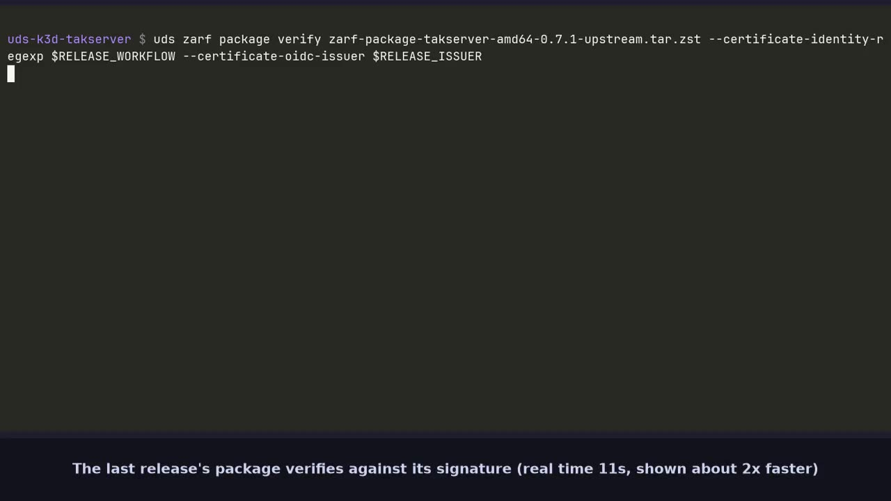

# Data

Use this page to check database settings, choose a backup method, restore data, and find logs for Team Awareness Kit (TAK) services.

[](https://github.com/jonathanagustin/uds-takserver/releases/download/demo/demo-clip-upgrade.mp4)

## Postgres

The upstream TAK chart installs Bitnami PostgreSQL in the `takserver` namespace. This package does not replace that database.

| Setting | Value |
| --- | --- |
| Service | `takserver-postgresql` |
| Port | 5432 |
| Database | `cot` |
| User | `postgres` |
| Password | the upstream example value `postgres` |
| Java Database Connectivity (JDBC) | `jdbc:postgresql://takserver-postgresql:5432/cot` in `CoreConfig.xml` |
| Image | `ghcr.io/jonathanagustin/uds-takserver/postgis:18-3.6` (amd64 and arm64) |
| Data directory | `/bitnami/postgresql/data` |

The chart also renders ConfigMap `postgres-configuration`. `pg_hba.conf` and `postgres.conf` are empty because the chart has no `extras/` files for them. Bitnami PostgreSQL 12.1.6 does not read `postgresql.configurationConfigMap`, so that object is not mounted. Postgres uses the chart defaults.

Those defaults are what the package ships. The nightly benchmark has measured these settings only at 10 clients for 60 seconds. That is why `values/` does not set `shared_buffers`, `work_mem`, `effective_cache_size`, `max_wal_size`, or `checkpoint_timeout`. The harness records `pg_stat_database`, `pg_stat_checkpointer`, `pg_stat_io`, and the `postgresql` container working set beside the TAK load.

`bench/configs/postgis-buffers.yaml` and `bench/configs/postgis-wal.yaml` apply those five parameters with `ALTER SYSTEM` and restart `takserver-postgresql`. `shared_buffers` is 128MB or 64MB, both under the 512Mi limit. `effective_cache_size` is a planner hint, not memory the server allocates. The sweep does not set `fsync=off`. A setting is copied into the package only after a harness report puts it on the front. The key for that is `postgresql.primary.extendedConfiguration`, which Bitnami appends under `conf.d`. On run 40174810574, at the chart defaults, the steady working set was 57Mi on amd64 and 59Mi on arm64.

The example password is public. Replace it and the matching JDBC password before deploying to a shared cluster.

CloudTAK's database is the same image. Its data directory is `/var/lib/postgresql/data/pgdata` on the `data-cloudtak-postgis-0` volume. See [CloudTAK](cloudtak.md).

## Upgrading from PostgreSQL 15

`18-3.6` is PostgreSQL 18 and PostGIS 3.6.4. Tag `15-3.4` stays in the registry. A deployment that has not moved keeps running that tag. A new install of `18-3.6` creates an empty cluster and loads PostGIS from the image's init script.

When an existing volume contains a PostgreSQL 15 cluster, the `18-3.6` entrypoint reads `PG_VERSION`, runs `pg_upgrade --link` with the PostgreSQL 15 binaries in the image, then `postgis_extensions_upgrade()` in every database that has PostGIS. The persistent volume claim (PVC), a Kubernetes `PersistentVolumeClaim`, is the same volume. TAK and CloudTAK each migrate when their own pod starts. The startup probe gives that first start ten minutes before Kubernetes restarts the pod.

`pg_upgrade --link` shares the table files with the new cluster and the entrypoint deletes the old directory after the new server has started. You cannot use that directory to run PostgreSQL 15 afterwards.

Before you roll the new image out:

1. Snapshot the volume, or run `pg_dumpall` from the PostgreSQL 15 pod and store the dump outside the cluster.
2. Deploy `18-3.6`.
3. Confirm `SHOW server_version_num` is 18 and `SELECT extversion FROM pg_extension WHERE extname = 'postgis'` is 3.6.

To roll back, restore the volume snapshot, set the image tag back to `15-3.4`, and start.

> [!WARNING]
> Do not point `15-3.4` at a data directory PostgreSQL 18 has already written.

A directory that is not PostgreSQL 15 or 18 makes the `18-3.6` container exit.

The upgrade test deploys the last release and writes a row. Then it deploys this branch and checks the row, its timestamp, the PVC, the server major version, and the PostGIS version. Since 0.7.0 the last release is already on PostgreSQL 18, so that job no longer runs the in-place upgrade from 15. A second job, `validate-upgrade-pg15`, pins release 0.6.0 with `UPGRADE_BASELINE_TAG=v0.6.0`, so the upgrade from 15 stays tested. It runs on pushes to `main`, and on a pull request with the `upgrade-pg15` label when a commit is pushed.

## Backup

For a step-by-step recovery procedure, see
[Back up and restore TAK Server](how-to/backup-and-restore.md).

Slim (`k3d-core-slim-dev`) does not install Velero. The full bundle does. `core-backup-restore` at `1.16.0-upstream` is a required package there, not an optional component. See [architecture decision record (ADR) 0016](../adr/0016-logical-db-dump.md).

Velero's default schedule is `velero-udsbackup`, daily at 03:00 Coordinated Universal Time (UTC), kept for 240h, `snapshotVolumes: false`. Unified Defense Stack (UDS) Core 1.16.0 does not deploy a node-agent, and k3d local-path has no snapshot application programming interface (API), so the default backup is API objects only. The Postgres files on the volume are not in it.

To cover the databases, the package stores a logical `pg_dump` in Secret `tak-db-dump` (database `cot`) and Secret `cloudtak-db-dump` (CloudTAK's PostGIS database). CronJobs `tak-db-dump` (02:15 UTC) and `cloudtak-db-dump` (02:20 UTC) refresh those Secrets. They render only when `backup.dump.enabled` is true, which the full bundle sets. A slim install does not create them.

`FILESYSTEM_BACKUP` defaults to `false`. Slim leaves it there. The full-core deploy (`bundle/full/uds-config.yaml`) sets it to `true`. That renders DaemonSet `node-agent` from `docker.io/velero/velero:v1.18.4` (amd64 and arm64, the same tag Core already runs), Exemption `velero-node-agent`, and `backup.velero.io/backup-volumes: data` on the Postgres and PostGIS pods. The Velero Package gets an egress allow to the Kubernetes API for pods labeled `name: node-agent`. See [ADR 0021](../adr/0021-velero-node-agent.md).

File-system backup needs volumes that are not hostPath. Velero skips a hostPath PersistentVolume (`isHostPathVolume` in Velero's `pkg/podvolume/backupper.go`), and k3d's default `local-path` class makes hostPath PersistentVolumes. So on a default k3d install the node-agent runs but copies nothing.

Use a Container Storage Interface (CSI) class, or on k3d a `local-path` variant with annotation `defaultVolumeType: local` (see `tests/local-path-local.sh`: uds-k3d runs the provisioner with a shared filesystem path, which gives no node affinity, so the variant needs its own `nodePathMap` under `storageClassConfigs`). Point the TAK Postgres volume at it with `POSTGRES_STORAGE_CLASS`, and the CloudTAK PostGIS volume with `CLOUDTAK_STORAGE_CLASS`. Both default to empty, which keeps the cluster default class. Set them only on a new install: a StatefulSet volume claim template cannot change on an upgrade. They are two variables so that setting one on an existing install does not also change the other StatefulSet. The full-core deploy creates `local-path-local` and sets both to it.

`bundle/full/uds-config.yaml` sets the three variables together:

```yaml title="uds-config.yaml"
variables:
  takserver:
    FILESYSTEM_BACKUP: "true"
    POSTGRES_STORAGE_CLASS: local-path-local
    CLOUDTAK_STORAGE_CLASS: local-path-local
```

Gzipped logical dumps work on every storage class. Keep them when file-system backup is enabled too.

What a namespace backup contains:

| Object | In the backup |
| --- | --- |
| ConfigMap `cert-migration` | Yes. Certificates and truststores. Private keys and keystores are removed from it. |
| Secret `takserver-certs` | Yes. Private keys and keystores the pods mount. A restored server presents the same certificate authority (CA). |
| Secrets `takserver-ca-key` and `takserver-keystore` | Yes. The CA key, and the keystore password. |
| Secret `takclient-enrollment` | Yes, in `takserver`. Watcher-only file-user passwords for TakClient renewal and recovery; never distribute it with device material. |
| Secret `cloudtak-tak-admin` and the Keycloak client Secrets | Yes. They are namespace objects. |
| Secrets `tak-db-dump` and `cloudtak-db-dump` | Yes, when the CronJob or `tests/backup-restore.sh` has written them. |
| TAK Postgres volume | Yes on the full-core deploy, where `FILESYSTEM_BACKUP=true` and the volume is on `local-path-local`. Velero copies the volume named `data`. Slim does not. The restore test still loads the logical dump after the namespaces come back. |
| CloudTAK PostGIS volume | Yes on the full-core deploy, where `FILESYSTEM_BACKUP=true` and `CLOUDTAK_STORAGE_CLASS` puts the volume on `local-path-local`. On the default k3d class the volume is hostPath, so Velero skips it. The `cloudtak-db-dump` Secret covers it either way. |
| Ignite | No. The cache is memory. Clients reconnect. |
| CoreConfig and the Ignite ConfigMap | Yes, as rendered objects. The chart can render them again from git. |

A Secret holds about 1Mi. Each Secret has key `dump.sql.gz`, the gzipped `pg_dump`. The CronJob refuses a gzipped dump over 700000 bytes. Past that, set `FILESYSTEM_BACKUP=true` so the node-agent copies the volumes. Leave the logical dump in place until a restore from the volume has been checked.

Without `takserver-certs`, `takserver-ca-key`, and `takserver-keystore`, enrolled client certificates no longer chain and the pods cannot open the keystores.

Restore, after Velero has put the namespaces back:

1. Record the current replica counts. Scale the TAK API, messaging, plugins, and config Deployments to 0, and scale CloudTAK to 0, so they do not write during the load. Wait until their pods have stopped; scaling alone does not wait for database connections to close.
2. Wait until `takserver-postgresql` and `cloudtak-postgis` are Ready.
3. If you need the logical dumps, load `tak-db-dump` into a fresh recovery database `cot` and `cloudtak-db-dump` into a fresh recovery database `cloudtak`. Do not load them over data recovered from a volume backup. Follow [the recovery procedure](how-to/backup-and-restore.md#steps) to prepare the databases.

   `tests/db-dump-secret.sh <namespace> <secret>` prints the SQL: it reads key `dump.sql.gz` and gunzips it, and falls back to key `dump.sql` for a Secret written before the dumps were gzipped, so an older backup restores the same way.

   In Bash, enable `set -o pipefail` before running the pipeline. For example, `tests/db-dump-secret.sh takserver tak-db-dump | kubectl exec -i -n takserver takserver-postgresql-0 -- psql -U postgres -d cot -v ON_ERROR_STOP=1`.
4. Restore the recorded replica counts (1 for the default install). Start config, messaging, API, and plugins in that order, waiting for each rollout. Start CloudTAK after TAK is ready. Enrolled client certificates still chain, because the cert ConfigMap and Secrets came back with the namespace.

`tests/backup-restore.sh` does this at the end of the full-core job, loading the dumps from the restored Secrets with `tests/db-dump-secret.sh`. It writes table `uds_restore_marker` in both databases, requires Backup `Completed` and Restore `Completed`, reads the marker back, and runs `tests/api-smoke.sh` with the client certificate copied out before the namespaces were deleted. On that deploy the node-agent has to log `Starting controllers`, and the Backup has to include a Completed PodVolumeBackup of the `takserver` volume `data` (`REQUIRE_FS_BACKUP=true`). Run by hand on a hostPath volume, the script skips that check with a message and still checks the logical dump.

The checkpoint MinIO is scaled to 0 by `fit-runner`; the script scales it back to 1 because Velero's default bucket `uds` is on that MinIO. BackupStorageLocation has to be `Available`.

## Find TAK logs

`k3d-core-slim-dev` does not install Vector or Loki. The per-PR tests check TAK startup on container stdout and stop there. A cluster with the `core-logging` layer ships that stdout to Loki. Query it through `loki-gateway` (port 80, API on `/loki`).

TAK startup, from the API process:

```logql
{namespace="takserver"} |= "Started TAK Server"
```

`TAK Server version` and `Tomcat started on port` are the same startup stream. Keep a line filter on this selector. `{namespace="takserver"}` alone is mostly Postgres, and a limit of a few hundred lines returns checkpoints before it returns the API startup line.

CloudTAK writes two lines of its own. `bootstrap.mjs` logs `ok - TAK user` after it creates the TAK user. `basemap.mjs` logs `basemap:` when it writes the tile proxy.

```logql
{namespace="cloudtak"} |= "ok - TAK user"
```

```logql
{namespace="cloudtak"} |= "basemap:"
```

A streaming client is logged by messaging. The callsign is the text after `to`. Substitute the device callsign. The disconnect line carries the subscription id, not the callsign.

```logql
{namespace="takserver"} |= "Set client for subscription" |= "CALLSIGN"
```

```logql
{namespace="takserver"} |= "Removed Subscription"
```

`/logs/takserver-api-access.log`, `/logs/takserver-db-audit.log`, and `/logs/takserver-esapi.log` are file-only. They are not in these queries. The test tasks print `Loki returned TAK logs`, `Loki returned CloudTAK logs`, and `Loki returned the streaming client callsign` when `core-logging` is installed. The client line is the callsign recorded by `tests/api-smoke.sh`.
