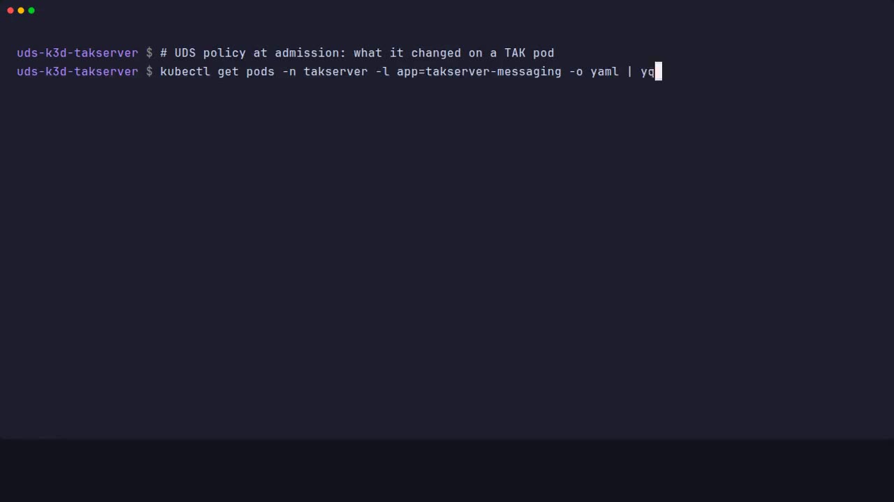
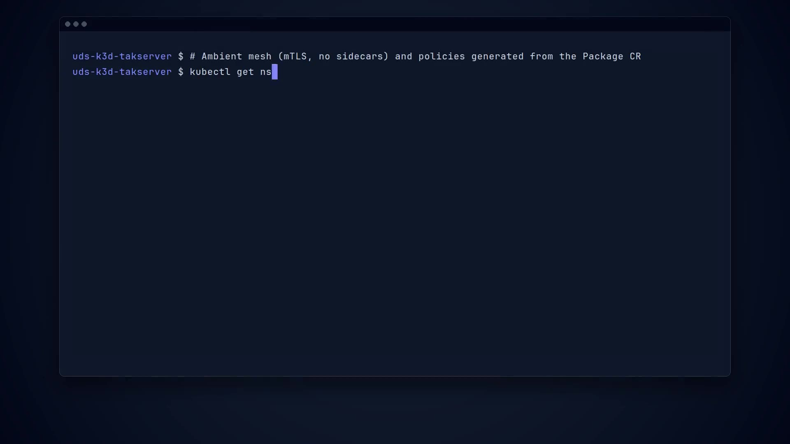

# Policy exemptions and security posture

UDS Core's policy engine validates and mutates every pod. A package has to keep its exemptions small and say why each one exists. This page lists every `Exemption` the package renders, and the one the optional ATAK test device adds, and the places where it deliberately differs from the default UDS posture.

`.github/scripts/check-exemptions.sh` renders the chart, reads `atak/deploy/*.yaml`, and fails when an `Exemption` has no `## <name>` section on this page. hk runs it when the chart, `atak/deploy/`, this page or the script changes. Add the section in the same change that adds the exemption.

`tests/exemptions.sh` (task `test:exemptions`, part of `test:all` on amd64 and arm64) audits the live cluster the way the UDS Core audit guide does. It fails in either of these cases:

- An `Exemption` that matches the `takserver` or `cloudtak` namespace is not the expected one, names other policies, or uses a bare wildcard.
- A pod in those namespaces is annotated `exempted` without a matching expected exemption.

It prints the exempted-resource list and the security context of each TAK pod.

[](https://github.com/jonathanagustin/uds-takserver/releases/download/demo/demo-clip-policy.mp4)

## Exemptions

Each section below is named after the `Exemption` object it describes.

## takserver-db-setup

- **Policy:** `RestrictIstioSidecarOverrides`
- **Matcher:** `^takserver-db-setup-.*`, kind `pod`, namespace `takserver`
- **Defined in:** `charts/takserver/templates/prereqs.yaml`
- **Why:** The upstream chart's post-install database Job sets the `proxy.istio.io/config` annotation so the schema container waits for an Istio sidecar. The chart has no value that removes it. Without the exemption the policy denies the Job's pod, and Helm waits out its timeout.
- **Why it is safe:** The package uses Istio ambient mode, which does not inject a sidecar. The annotation has no effect on the mesh here. The matcher is the one hook Job name, not a wildcard.
- **What removes it:** An upstream chart that makes the annotation optional or drops it.

## velero-node-agent

Rendered only when `FILESYSTEM_BACKUP=true`. A default install does not create it. See [ADR 0021](../adr/0021-velero-node-agent.md).

- **Policies:** `DisallowPrivileged`, `RequireNonRootUser`, `DropAllCapabilities`, `RestrictCapabilities`, `RestrictHostPathWrite`, `RestrictVolumeTypes`, `DisallowHostNamespaces`, `RestrictSELinuxType`
- **Matcher:** `^node-agent-.*`, kind `pod`, namespace `velero`
- **Defined in:** `charts/takserver/templates/filesystem-backup.yaml`
- **Why:** The node-agent is privileged so it can mount pod volumes from `/var/lib/kubelet/pods` on the node. That is host path, a host volume type, and a root process.
- **Why it is safe:** The matcher is the node-agent pods in the `velero` namespace. Nothing in `takserver` or `cloudtak` is exempted. The DaemonSet exists only when file-system backup is turned on.
- **What removes it:** Leaving `FILESYSTEM_BACKUP` at its default, or a Velero release that can copy the volumes without host access.

Second entry, `Velero data mover`:

- **Policies:** `DisallowPrivileged`, `RequireNonRootUser`, `DropAllCapabilities`, `RestrictHostPathWrite`, `RestrictVolumeTypes`
- **Matcher:** `.*`, kind `pod`, namespace `velero`
- **Why:** Velero 1.18 copies each volume in a pod the node-agent creates for every PodVolumeBackup and PodVolumeRestore. It runs as root and mounts `/var/lib/kubelet/pods` read-write (a restore writes into it). `node-agent-config` sets `privilegedFsBackup: true`, so the pod is privileged: root without capabilities cannot open a directory such as the Postgres data directory, which is mode 0700 for the postgres user (the unprivileged pod failed with `open .../data: permission denied`). Velero's own labels on it (`velero.io/pod-volume-backup`, `velero.io/pod-volume-restore`) hold the PVB or PVR name, which changes each backup, so they cannot be matched. ConfigMap `node-agent-config` makes the node-agent add a fixed label, `app.kubernetes.io/component: velero-data-mover`, to every data-mover pod, but the Exemption custom resource definition (CRD) in UDS Core 1.16.0 rejects `matcher.podLabels` (field not declared in schema). So the matcher is every pod in the `velero` namespace. When the bundle moves to a Core version whose matcher has `podLabels`, narrow it to that label.
- **Why it is safe:** Only the `velero` namespace, which holds only Velero's own pods, and only these five policies. It exists only when file-system backup is on.

## kubevirt

Only the optional ATAK test device uses this. It is not part of the package: `atak/deploy/kubevirt-exemption.yaml` is applied by the ATAK end-to-end workflow, and a normal install never creates it. It is one `Exemption` object with three entries.

- **Defined in:** `atak/deploy/kubevirt-exemption.yaml`
- **KubeVirt node agent** (`virt-handler-*`, namespace `kubevirt`)
  - **Policies:** `DisallowPrivileged`, `RequireNonRootUser`, `DropAllCapabilities`, `RestrictCapabilities`, `RestrictHostPathWrite`, `RestrictVolumeTypes`, `DisallowHostNamespaces`, `RestrictSELinuxType`
  - **Why:** `virt-handler` is a privileged node agent. It opens `/dev/kvm`, manages the launcher pods' network namespaces and mounts the containerDisk, so it needs host paths, host PID and privileged mode.
- **KubeVirt control plane** (`virt-(operator|api|controller|exportproxy)-*`, namespace `kubevirt`)
  - **Policies:** `RequireNonRootUser`, `DropAllCapabilities`, `RestrictVolumeTypes`
  - **Why:** These run as non-root, but the operator does not set every field the UDS defaults expect.
- **ATAK test device VM launcher** (`virt-launcher-atak-device-*`, namespace `atak`)
  - **Policies:** `RestrictCapabilities`, `DropAllCapabilities`, `RestrictVolumeTypes`, `RestrictHostPathWrite`, `RestrictIstioTrafficOverrides`
  - **Why:** `virt-launcher` runs the device VM as UID 107 and adds `NET_BIND_SERVICE` for masquerade networking. KubeVirt always sets the `traffic.sidecar.istio.io/kubevirtInterfaces` annotation on launcher pods. It only matters to Istio sidecars and there is none here, so it changes nothing.
- **Why it is safe:** Every matcher names the KubeVirt components or the one launcher name pattern, in the `kubevirt` and `atak` namespaces. Nothing in the `takserver` or `cloudtak` namespaces is exempted.
- **What removes it:** Not running the ATAK test device, or a KubeVirt release that sets these fields itself.

## Differences from the default UDS posture

These are not exemptions. The policy engine mutates these settings or leaves them alone, so no `Exemption` object exists.

[](https://github.com/jonathanagustin/uds-takserver/releases/download/demo/demo-clip-secure.mp4)

### Non-root user and writable root filesystem

The TAK images default to `USER 0`, and the upstream Deployments set no `securityContext`. UDS Core's policy engine fills it in when each pod is admitted. `test:exemptions` prints the result on every CI run. On amd64 and arm64 every TAK pod (api, config, messaging, plugins, ignite, nats, the database setup hook, postgresql) runs with:

- pod: `runAsUser: 1000`, `runAsGroup: 1000`, `runAsNonRoot: true`. PostgreSQL also has `fsGroup: 1001`, and its container runs as `1001`.
- each container: `allowPrivilegeEscalation: false`, `capabilities.drop: ["ALL"]`.

TAK still starts because the image makes the directories it writes world-writable (`/certs`, `/logs`, `/conf`, `/work` and the TAK work and log directories under `/opt/tak`). The root filesystem stays writable. A read-only one would mean forking the upstream Deployments. See [ADR 0005](../adr/0005-slim-core-boundaries.md) and [Configuration](configuration.md).

### Ambient mesh instead of sidecars

Both Package CRs set `serviceMesh.mode: ambient`. Passthrough TLS on 8443, 8446, and 8089 has to reach TAK unchanged, and there is no waypoint and no Authservice in front of TAK. See [Networking](networking.md).

## UDS package requirements

The [UDS package requirements](https://docs.defenseunicorns.com/core/concepts/configuration--packaging/package-requirements/) are a pre-publish checklist. These are the items this package does not meet, or meets only through the exception the requirement allows.

### Metrics monitor

- **Requirement:** Implement a monitor for each application metrics endpoint, unless the application provides no metrics.
- **Status:** Met for the TAK API, TAK messaging, and the `takserver-oidc` module when the monitoring API is installed. Slim omits the monitors. Postgres and NATS are not scraped. Their exporter images are not built here.
- **Details:** [ADR 17](../adr/0017-prometheus-monitors.md) and [Configuration](configuration.md).
- **What changes it:** Building multi-arch Postgres and NATS exporter images, and enabling them without an upstream chart change that this package does not carry.

### Commands in Zarf actions

- **Requirement:** Zarf actions use only `coreutils` or `./zarf` self references.
- **Status:** Met. The `onDeploy` actions that ran `sed`, `python3`, and `patch-oidc-pods.py` are gone. The `takserver-oidc` Pepr module adds the init containers at admission, writes the CoreDNS rewrite, and copies the gateway CA and the CloudTAK admin material. `onCreate.before` runs `pepr/build.sh` when the package is created, which is not a deploy action.
- **What removes it:** Nothing further. The init containers and the CoreDNS rewrite live in the Pepr module. A scale-down remains only when Ignite was admitted without the tuned config.

### Zarf values

- **Requirement:** Prefer Zarf Values over Zarf Variables where Zarf supports them. Values is beta, so variables stay for compatibility.
- **Status:** Met, with the four variables kept on purpose. `values/zarf-values.yaml` and `values/zarf-values.schema.json` hold `global.domain`, `tak.imageTag`, `dns.inCluster`, and `dns.passthroughHosts`. Chart mappings and the templated Pepr values file read those. Each value defaults to its variable's placeholder, so `DOMAIN`, `TAK_IMAGE_TAG`, `IN_CLUSTER_DNS`, and `PASSTHROUGH_HOSTS` still decide the result unless a package value is set. A UDS CLI 0.40 bundle sets Zarf variables and has no package-values input, and the `images:` list and `certs.image` cannot take a package value. [Configuration](configuration.md#package-values) has the table.
- **What removes the variables:** A bundle CLI that can pass package values, and a cert image built from `tak.imageTag` instead of one substituted string.

### Package template

Compared with [uds-packages/template](https://github.com/uds-packages/template). This repo already has the pieces that fit: root `zarf.yaml`, `common/zarf.yaml`, a config chart plus the upstream chart, `values/`, `bundle/`, `tasks.yaml`, `tests/`, `adr/`, `docs/`, CODEOWNERS, Renovate, and the lint and release workflows. It does not collapse to one `chart/` directory, because TAK and CloudTAK are separate charts. It does not add `releaser.yaml` or `uds-pk release`. [Version scheme](#version-scheme) says why release-please stays. It does not add a `registry1` flavor. [Image flavors](#image-flavors) says why.

### Version scheme

- **Requirement:** Versions follow `<upstream-app-version>-uds.<n>`, or Semantic Versioning when that scheme does not apply.
- **Status:** Semantic Versioning. release-please sets the version from Conventional Commits, and the published package tag is `<version>-upstream`, for example `0.3.0-upstream`. The package ships two upstream applications with separate versions, TAK Server `5.7-RELEASE-14` and CloudTAK (the `appVersion` in `charts/cloudtak/Chart.yaml`), so no single application version leads the tag. release-please stays instead of the template's `<upstream-app-version>-uds.<n>` tag and `uds-pk release` flow, because that second publisher would also have to bump `charts/takserver/Chart.yaml`, `common/zarf.yaml`, and `README.md`, which release-please already owns.

### Image flavors

- **Requirement:** A package that can run in a DoD environment ships a `registry1` flavor whose images come from Iron Bank (`registry1.dso.mil`), alongside `upstream`.
- **Status:** Only `upstream`. There is no `registry1` flavor. Iron Bank has some related images, and none of them are the images this package runs.
- **TAK Server.** Iron Bank publishes one server image, `registry1.dso.mil/ironbank/tpc/tak/tak-server`. Its README pulls tag `5.5`. It also publishes `tpc/tak/tak-server-db`. This package runs six images built here from `5.7-RELEASE-14`: `takserver-api`, `takserver-messaging`, `takserver-config`, `takserver-plugins`, `takserver-database-setup`, and `takserver-ignite`. Those names are not on Iron Bank, and `5.5` is not this package's release.
- **CloudTAK.** No CloudTAK project showed up on repo1. The `cloudtak` image is built here from the upstream submodule.
- **PostGIS.** Iron Bank publishes `opensource/postgres/postgresql-15/postgis15` (a findings issue names tag `15-3.6.3`). TAK and CloudTAK use `postgis:18-3.6`, built here. TAK's chart is still the upstream Bitnami chart; the image override points it at that build.
- **NATS.** Iron Bank publishes `opensource/synadia/nats-server` and `opensource/synadia/nats-box`. This package pins `docker.io/library/nats:2.15.1-alpine` and `docker.io/natsio/nats-server-config-reloader:0.25.0`. The reloader did not show up on repo1, and the server project is not tag `2.15.1`.
- **ATAK viewer.** No ATAK-CIV image showed up on repo1. The viewer is a separate package, built here.
- **What changes it:** Iron Bank images that match those names and tags, and chart values that can point at them without forking the upstream chart. Until then the package does not pretend a values overlay is a `registry1` flavor.

## Falco

UDS Core's runtime security layer is Falco. Only the stable ruleset is on, and alerts go to Loki through Falcosidekick. UDS already disables `Contact K8S API Server From Container` for the whole cluster. This package does not disable another rule.

The full bundle adds one custom rule, `TAK cert write outside the JVM`, on the `uds-falco-config` value `extraRules`. It matches a write under `/opt/tak/certs` in the `takserver` namespace by a process whose name is not `java`. It skips the `certs` container of the `takserver-cert-init` Job, which creates the certificates with `makeCert.sh`, `openssl`, and `keytool` on purpose. In Full Core run 41595868023, that container caused all 39 events on each architecture. The rule's output names the process, its path, and its parent, not the command line, because those tools take keystore passwords as arguments. `tests/falco-events.sh` creates `/opt/tak/certs/falco-probe-test` with `touch` in the API container and requires that file name in Loki.

The same script writes every Falco event whose payload names `takserver`, `cloudtak`, or `pepr-system` to `out/falco-events.txt`, and the full-core job uploads that file. When the test fails before it reaches this script, the job runs it with `FALCO_COLLECT_ONLY=1`. That writes the same file and skips the labeled write, so a failed run still uploads its events. In that run, no stock rule fired for those namespaces, so no stock-rule exception is added. Stock rules print the full command line. Before anything is printed or uploaded, `.github/scripts/redact-logs.py` masks the values after `-storepass`, `-keypass`, `-key`, `-passin`, `-passout`, `-password`, and `pass:` in the events file and the debug logs.

## Adding an exemption

1. Keep the matcher as narrow as it can be. Use `.*` only when a narrower supported matcher cannot identify the workload. Limit it to one namespace and the required policies, and document why the wildcard is necessary and what would remove it (as for [Velero data movers](#velero-node-agent)).
2. Name only the policies the workload triggers.
3. Add a section above with the policy, matcher, reason, and what would remove it.

## Airgap validation

The Test workflow adds `validate-install (amd64, airgap)`. It retrieves the slim
checkpoint and creates the package and test bundle first. Before it deploys TAK
or CloudTAK, CI pins the airgap bundle's TAK image tag to the same immutable
input tag included in the package. This keeps certificate setup and the other
TAK pods from requesting an unpackaged mutable tag. Then
`.github/scripts/node-airgap.py` installs a dedicated filter chain
inside each k3d server and agent container's network namespace. Both node-origin
`OUTPUT` and pod-forwarded `FORWARD` traffic are covered. The host firewall,
Docker daemon, and other containers are unchanged. The guard rejects host and
shared-container network modes before installing or restoring rules, even if a
container carries k3d labels. Network namespaces have
[separate firewall rules](https://man7.org/linux/man-pages/man7/network_namespaces.7.html).

The allow list comes from the cluster's Docker networks, Kubernetes pod CIDRs,
and existing Service addresses. It also covers the ambient mesh's synthetic DNS
addresses and IPv6 link-local discovery. Other IPv4 and IPv6 destinations are
rejected. Docker's embedded DNS forwarder is rejected separately so it cannot
relay external queries through the runner. Kubernetes DNS and the tenant
and passthrough gateways are checked by the existing `test:all` suite.

A public-IP HTTP transport control must be reachable from every node before
blocking, with no successful request or HTTP response after blocking. BusyBox
wget uses `-Y off` to bypass proxies and `-S` to report response headers. Receipt
of any HTTP status, including a redirect or error followed by a failed transfer,
proves network reachability; it does not prove resource health. Failure with no
HTTP response fails preflight instead of passing an endpoint outage as isolation.
The IP literal prevents an initial DNS failure from masquerading as enforcement.
This improves the control's transport semantics; it does not establish that TLS
or a redirect caused the earlier CI preflight failure. The suite then installs and starts TAK and CloudTAK from
the packaged images, creates the test identities, and runs `test:all`, including
SSO, client certificates, CoT streaming, file transfer, and the CloudTAK map.
`basemap.enabled=false` removes the external tile source. The browser test still
checks sign-in and the TAK connection, and requires no packaged basemap or tile
requests in this variant. The last step repeats the denied control and prints
filter counters.

This is a node and workload egress test. The test runner remains online for
package signature verification and host-side test dependencies. It can still
reach the Kubernetes API and GitHub; it is not a test of an offline workstation.
The trusted runner and Docker bridge services stay reachable from the nodes.

An EXIT/signal trap restores the dedicated chains, and an `always()` workflow
step retries restoration after a step timeout or cancellation. Restoration
removes only this test's chain and jumps. All firewall listings use numeric
addresses so cleanup does not wait for reverse DNS while DNS egress is blocked.
A killed or unreachable runner may
prevent cleanup; GitHub then destroys that job's ephemeral cluster.

Run it on Linux with Docker and a fresh test cluster using `uds run test-airgap`.
The node image must provide `wget`, `iptables`, and, when IPv6 is enabled,
`ip6tables`. The job fails instead of silently leaving an address family open.
The optional Docker integration test exercises local allowed and denied
networks, a still-reachable host connection, packet counters, and restoration:

```bash title="Check firewall isolation with local Docker traffic"
docker build --secret id=ca,src=/etc/ssl/certs/ca-certificates.crt \
  -t tak-airgap-firewall-test tests/fixtures/airgap
AIRGAP_FIREWALL_INTEGRATION=1 AIRGAP_WGET_INTEGRATION=1 AIRGAP_CLEANUP_INTEGRATION=1 \
  python3 -B -m unittest tests.test_node_airgap -v
```

`AIRGAP_WGET_INTEGRATION=1` also runs actual BusyBox wget against an isolated
local HTTP redirect fixture, with an unreachable TLS target and deliberately
invalid proxy settings. It tests transport classification without public egress
or firewall changes. `AIRGAP_CLEANUP_INTEGRATION=1` runs a private-container
DNS blackhole fixture: the old named listing times out, while numeric listing
and the real restore routine finish and remove the dedicated chain.

Set `AIRGAP_FIREWALL_IPV6=1` as well to exercise IPv6 Docker networks on a
host with IPv6 packet filtering. The managed development environment supports
the IPv4 test but cannot create an IPv6 Docker network because its kernel lacks
the IPv6 filter table. The production guard still refuses to proceed with an
enabled but unfilterable IPv6 stack.

### Recorded application validation

Main revision `3cf5084f81d54641fab7d55b938d0c5dd733e017` passed
[Test run 42450853308](https://github.com/jonathanagustin/uds-takserver/actions/runs/42450853308),
including [the complete amd64 airgap job](https://github.com/jonathanagustin/uds-takserver/actions/runs/42450853308/job/128640860481)
on November 8, 2026. The job ran `uds run test-airgap` with the airgap bundle's
external basemap disabled. Its log records:

- At 05:39:12 UTC, the node's external IP control was reachable before
  isolation and denied after isolation.
- Installation and `test:all` completed under the guard, including the SSO
  browser workflows and TAKClient tests. At 05:52:55 UTC, the live revocation
  checks passed: the revoked stream closed, reconnect was rejected, and the
  unrevoked client, administrator and CloudTAK continued working without a TAK
  restart.
- At 05:52:56 UTC, the external IP control remained denied. The IPv4 catch-all
  reject rule recorded two packets and 120 bytes. The log also retained the
  IPv6 filter chain with its catch-all reject rule; that rule recorded zero
  packets, so this does not demonstrate an external IPv6 connection attempt.
- At 05:52:57 UTC, cleanup reported restored node egress with the host firewall
  unchanged. The separate always-run restoration step succeeded and found no
  active state. The entire job, including cleanup and log staging, passed at
  05:53:15 UTC.

This completes the recorded node/workload egress installation and core-flow
validation requested by [issue 256](https://github.com/jonathanagustin/uds-takserver/issues/256).
It does not establish an offline workstation, offline UDS Core bootstrap, or
cloud-provider installation. The runner and trusted Docker bridge remained
reachable as described above. Local firewall fixtures remain complementary
checks, rather than substitutes for this application result.
