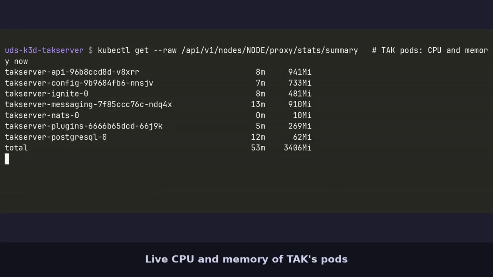

# Values profiles

This page describes two named values overlays, `small` and `production`. Neither is the package default. The nightly benchmark measures both (see [Benchmarks](benchmarks.md)), but only at 10 clients for 60 seconds. Neither is a sizing result yet. Package bytes per component are unmeasured too. CloudTAK is already an optional component (`required: false` in `zarf.yaml`). Small does not drop another one.

The footprint below is the steady working set from `tests/usage.sh` at the end of install on [run 40174810574](https://github.com/jonathanagustin/uds-k3d-takserver/actions/runs/40174810574). The source is the kubelet Summary API, the same one `bench/run.py` reads. The higher of amd64 and arm64:

| Container | CPU | Working set |
| --- | --- | --- |
| api | 66m | 911Mi |
| messaging | 26m | 888Mi |
| config | 11m | 750Mi |
| Ignite | 48m | 488Mi |
| plugins | 17m | 263Mi |
| Postgres | 10m | 59Mi |
| CloudTAK | 62m | 146Mi |
| sso | 32m | 67Mi |
| bootstrap | 0m | 19Mi |
| CloudTAK PostGIS | 33m | 96Mi |
| NATS | 2m | 8Mi |
| NATS reloader | 0m | 5Mi |

Heaps stay `-Xmx512m` on api, messaging, and config. A 1Gi messaging cgroup ran out of memory and was killed when UserManager started, so neither profile sets a messaging memory limit under 1536Mi.

[](https://github.com/jonathanagustin/uds-k3d-takserver/releases/download/demo/demo-clip-self-healing.mp4)

## Default

`values/common-values.yaml` is baked into the package. `charts/cloudtak/values.yaml` is the CloudTAK chart default. CI deploys `bundle/test-values.yaml` on top of the package. Those paths stay the default so the Test workflow does not change with this document. Pick a profile by adding it to a bundle. Do not use a profile as the only values file. It does not carry image names or passwords.

NATS requests and limits stay in `values/common-values.yaml` (10m and 32Mi, limit 250m and 128Mi; reloader 5m and 16Mi, limit 50m and 32Mi). The profiles do not override them.

## small

`values/profiles/small.yaml` and `values/profiles/small-cloudtak.yaml`. One node, requests just above the table, limits with a little room. Postgres memory limit is 512Mi. API, messaging, and Ignite memory limits stay 1536Mi.

The plugins Deployment does not read a memory value from the chart, so a profile cannot change it. See [Plugins memory](#plugins-memory).

TAK, CloudTAK, and NATS memory limits, counting the 512Mi plugins limit, sum to about 8992Mi of the ~15984Mi runner.

## production

`values/profiles/production.yaml` and `values/profiles/production-cloudtak.yaml`. Same single replica. More CPU and memory headroom than small. API and messaging memory limits are 2Gi because the messaging pod copies the API limit. Postgres stays at 512Mi so `shared_buffers` cannot fill a larger cgroup. The same sum, with the 512Mi plugins limit, is about 11040Mi and still fits the runner. CPU limits add up to more than 4 because startup has needed a whole core; that overcommit is on purpose.

Messaging and API replicas are 1. A second pod overwrites CoreConfig with the cached copy ([#3](https://github.com/jonathanagustin/uds-k3d-takserver/issues/3)). The upstream example's replica counts are not used.

## Apply

Paths are relative to the bundle file. This replaces the test bundle's `test-values.yaml` entry when you want the profile instead of the CI sizes. Chart `uds-cloudtak` is CloudTAK.

```yaml
overrides:
  takserver:
    takserver:
      valuesFiles:
        - ../values/profiles/small.yaml
    uds-cloudtak:
      valuesFiles:
        - ../values/profiles/small-cloudtak.yaml
```

Use `production.yaml` and `production-cloudtak.yaml` the same way.

## Plugins memory

The `takserver-workload` capability in the Pepr module sets the plugins memory, not the chart. The defaults are request 320Mi and limit 512Mi. The plugin heap is 128m, and the steady working set was about 263Mi. The harness configs use the same values.

To change it, set the `PLUGINS_MEMORY_REQUEST` and `PLUGINS_MEMORY_LIMIT` variables, for example in a bundle's `uds-config.yaml`:

```yaml
variables:
  takserver:
    PLUGINS_MEMORY_REQUEST: 400Mi
    PLUGINS_MEMORY_LIMIT: 768Mi
```

Or set the `tak.plugins.memoryRequest` and `tak.plugins.memoryLimit` package values, which override the variables. Admission and the watcher both read them. The schema rejects a package value that is not a memory quantity, such as `512mi`. A variable is not checked before deploy. With a bad variable, admission rejects the four TAK Deployments, and the error names the variable.

## Harness

`bench/configs/small.yaml` and `bench/configs/production.yaml` set the memory request and limit from these profiles on the running cluster. `kubectl set resources` does not take a CPU value, so the CPU numbers exist only in the values files. The nightly job writes `bench/out/<arch>/<config>.json`. The nightly records are 10 clients only, so do not treat either profile as a sizing result yet.
